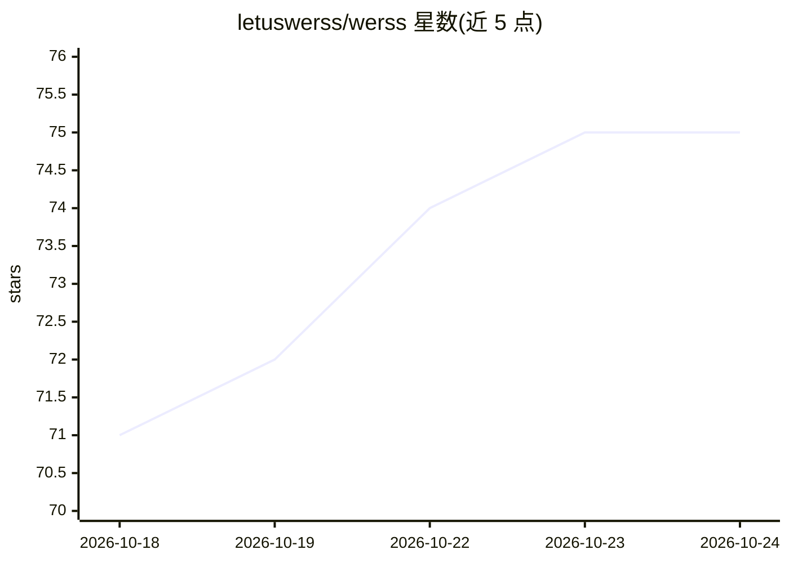

# letuswerss/werss

⭐ 75 · TypeScript · MIT · 推送 2026-04-28 · [GitHub](https://github.com/letuswerss/werss) · [官网](https://letuswerss.github.io/werss/) · 组织维护 · 中文 README

**自托管微信公众号聚合与 AI 分析系统，输出 RSS 与热点**

面向个人私有自托管场景的微信公众号内容整理与分析系统：定时采集文章（web/api/app 三种模式），输出标准 RSS 2.0 订阅源（摘要/全文），提供标签管理（手动及基于 OpenAI 兼容接口的 AI 自动提取，可接 DeepSeek/OpenAI/Qwen）、热点主题发现、PDF/Markdown 导出、MinIO 存储、钉钉/企业微信/飞书通知与后台管理，API 支持 JWT/API Key 鉴权。README 明确不建议部署为公开内容聚合或对外分发服务。提供一键脚本、手动安装与 Docker Compose 部署方式。

## 筛选速览

| 维度 | 判定 | 备注 |
|---|---|---|
| AI 角色 | `ai-enhanced` | 去掉 AI 部分产品仍成立 |
| 许可风险 | `permissive` | MIT |
| 部署形态 | `self-host` | docker 或自建部署 |
| 模型依赖 | — | README 未给出锁定关系 |
| 硬件要求 | — | 无带数字的原话,不猜 |
| 安装摩擦 | `low` | 无编译、无系统依赖或容器化 |
| 成熟度 | — | 结构信号不足 |

## 能力要点

- web/api/app 三种采集模式与定时任务调度
- 基于 OpenAI 兼容接口的 AI 标签提取（DeepSeek/OpenAI/Qwen）
- 从近期文章聚合事件型热点主题并输出热点 API
- 摘要/全文 RSS 2.0 输出与钉钉/企业微信/飞书 Webhook 通知

## 适用场景

- 私有订阅微信公众号并生成 RSS 源供阅读器使用
- 自动整理文章标签并发现近期热点主题
- 通过消息模板定时汇总公众号推送到钉钉/飞书等平台

## 场景标签

`网页抓取` · 领域:效率与自动化

## 证据(README 行号)

> L21: WeRSS 是一个面向个人私有自托管场景的微信公众号内容整理与分析系统。它提供文章订阅管理、摘要 RSS 输出、标签整理、热点追踪、消息通知和后台管理能力，适合作为个人信息处理工具使用，**不建议部署为公开内容聚合、全文转载或对外
> L55: - 🏷️ **标签体系**：支持手动管理标签，并支持基于 OpenAI 兼容接口的 AI 自动提取

## 星数曲线

2026-10-18 71 → 2026-10-24 75（+4）

---
*卡片 v1 · prompt 1.4 · 生成 2026-10-24 · 置信度 mid · 依据 README sha `4b4b8bec6773` · [字段定义](../../DATASET.md)*
