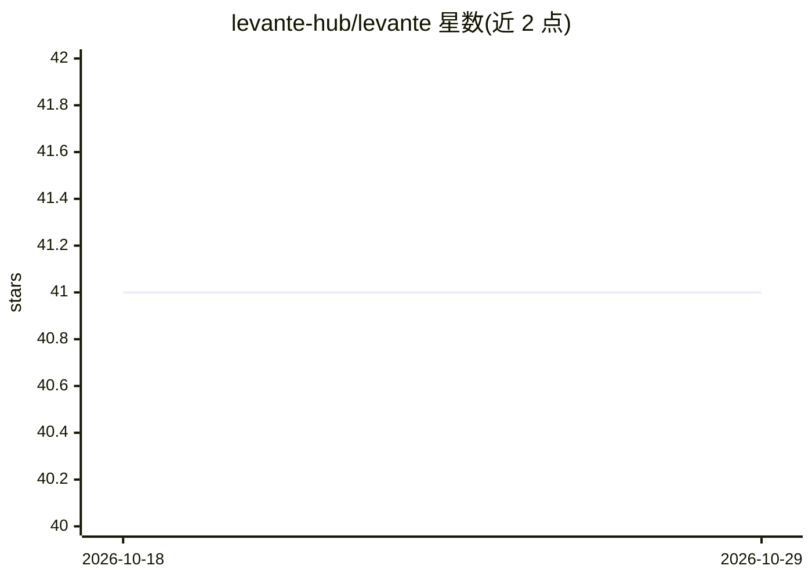

# levante-hub/levante

⭐ 41 · TypeScript · NOASSERTION · 推送 2026-04-28 · [GitHub](https://github.com/levante-hub/levante) · [官网](https://www.levanteapp.com) · 组织维护

**跨平台桌面 MCP 客户端：多源接入 AI，本地存储对话**

面向普通用户与技术用户的 Windows/macOS/Linux 桌面应用，提供多模态聊天（文本/图像/可选音频）与完整 MCP 客户端能力（Tools/Prompts/Resources）。支持 OpenRouter、Vercel AI Gateway、Ollama、LM Studio、OpenAI、Anthropic、Google、Groq 等多种接入方式，含 MCP Store 与 MCP-UI 流程，从文档/URL 自动提取 MCP 配置。对话与设置仅本地存储，API key 使用系统钥匙串加密。当前为 Open Beta，许可为 Apache 2.0 with Commons Clause（source-available）。

## 筛选速览

| 维度 | 判定 | 备注 |
|---|---|---|
| AI 角色 | `ai-native` | 本体是模型或模型工具 |
| 许可风险 | `permissive` | NOASSERTION |
| 部署形态 | `None` |  |
| 模型依赖 | local-ok | 支持本地模型 |
| 硬件要求 | — | 无带数字的原话,不猜 |
| 安装摩擦 | `low` | 无编译、无系统依赖或容器化 |
| 成熟度 | `idea` | |

## 能力要点

- 完整 MCP 客户端：Tools/Prompts/Resources，含 MCP Store 与 MCP-UI 流程
- 多接入方式：OpenRouter、Vercel AI Gateway、Ollama/LM Studio 本地模型、直连 OpenAI/Anthropic/Google 等
- 本地存储对话与设置，API key 系统钥匙串加密，本地模型可离线使用
- 自动模型同步与能力检测（vision/speech）

## 适用场景

- 在桌面端统一使用多家云端与本地模型聊天
- 在聊天中直接调用 MCP 服务器的工具与资源
- 非技术用户通过引导式设置接入 MCP 服务器

## 场景标签

`聊天机器人` · 领域:对话与助手

## 证据(README 行号)

> L10: Levante is a cross-platform desktop app (Windows, macOS, Linux) that brings powerful AI tools closer to everyone — 
> L52: ### Model Context Protocol (MCP)
> L54: Levante is a full MCP client, supporting:

## 星数曲线

2026-10-18 41 → 2026-10-29 41（+0）

---
*卡片 v1 · prompt 1.4 · 生成 2026-10-25 · 置信度 high · 依据 README sha `47e6e78c8b2b` · [字段定义](../../DATASET.md)*
