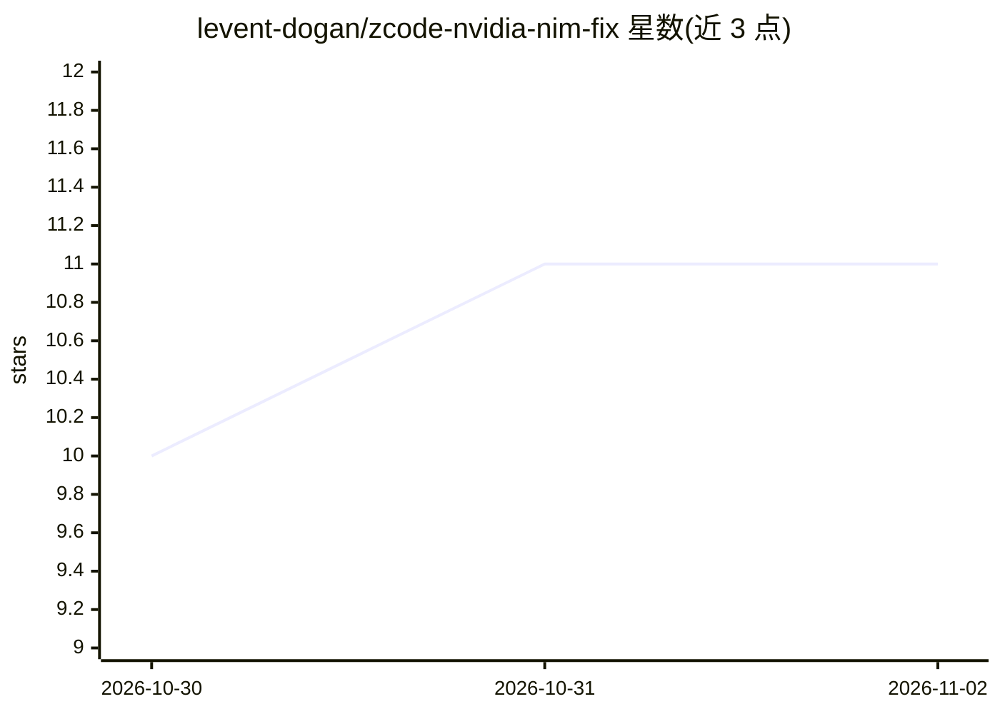

# levent-dogan/zcode-nvidia-nim-fix

⭐ 11 · Python · MIT · 推送 2026-10-04 · [GitHub](https://github.com/levent-dogan/zcode-nvidia-nim-fix) · 个人维护

**本地代理：修复 ZCode/OpenCode 调用 NVIDIA NIM 时的 extra_body 报错**

面向 Windows 的本地 OpenAI 兼容 Chat Completions 代理，部署在 IDE 客户端与 NVIDIA NIM 上游之间。起始用途是剥离 ZCode 发送的 NVIDIA 拒收的 extra_body 字段，现支持按模型映射请求、最多六把密钥的私有 API-key 池与健康轮换、有界队列、SSE 流式转发、缓存模型目录及可选的 OpenCode 模型同步（含按模型 ID 的上下文限制注册表）。提供三种密钥模式（Pool/Client/Env），通过 run_proxy.ps1 启动，无第三方运行时依赖。不实现 Responses、Embeddings、图像等 API，也不改变上下文窗口与配额限制。

## 筛选速览

| 维度 | 判定 | 备注 |
|---|---|---|
| AI 角色 | `ai-ecosystem` | LLM/agent 周边工具 |
| 许可风险 | `permissive` | MIT |
| 部署形态 | `desktop` | 安装包/桌面程序 |
| 模型依赖 | — | README 未给出锁定关系 |
| 硬件要求 | — | 无带数字的原话,不猜 |
| 安装摩擦 | `low` | 无编译、无系统依赖或容器化 |
| 成熟度 | — | 结构信号不足 |

## 能力要点

- 剥离 NVIDIA 拒收的请求字段，保留消息与结构化工具调用
- 三种 API-key 模式，Pool 模式支持最多六把密钥轮换、隔离 401/403 密钥
- OpenCode 模型同步与按精确模型 ID 的上下文/输出预算注册表
- 无第三方运行时依赖，PowerShell 启动器自动激活 venv

## 适用场景

- 让 ZCode/OpenCode 通过自定义 base URL 调用 NVIDIA NIM 聊天模型
- 多个本地项目共享一组 NVIDIA API 密钥并自动轮换
- 为 OpenCode 自动同步 NVIDIA 目录中的聊天模型与上下文限制

## 场景标签

`模型网关` · 领域:Agent 开发

## 证据(README 行号)

> L3: `zcode-nvidia-nim-fix` is a local OpenAI-compatible Chat Completions proxy for NVIDIA NIM. It started as a workaroun
> L12: |Chat endpoint|`POST /v1/chat/completions`|

## 星数曲线

2026-10-30 10 → 2026-11-02 11（+1）

---
*卡片 v1 · prompt 1.4 · 生成 2026-11-02 · 置信度 mid · 依据 README sha `c927b2cc48f5` · [字段定义](../../DATASET.md)*
