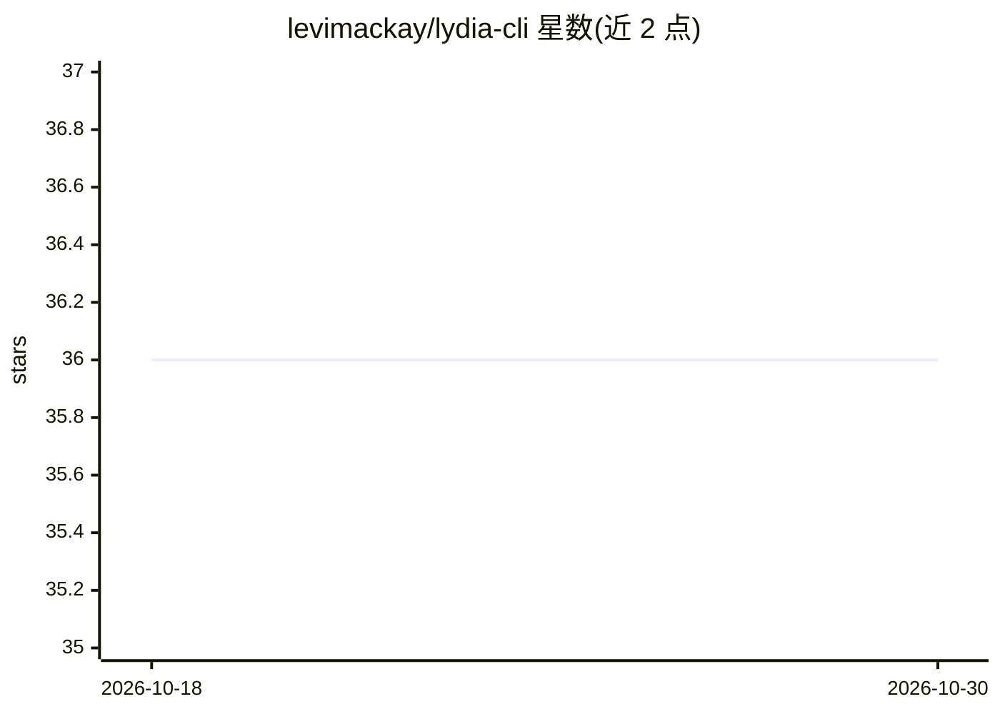

# levimackay/lydia-cli

⭐ 36 · Python · MIT · 推送 2026-09-25 · [GitHub](https://github.com/levimackay/lydia-cli) · 个人维护

**终端本地 AI 编程代理：用本地 Ollama 读写代码、跑命令、驱动 git**

面向个人开发者的命令行 AI 编程代理，默认通过本地 Ollama 模型读取/编辑文件、运行 shell 命令、驱动 git，并可用 verify_command 闭环自检测试。提供 ask/auto/plan 三级权限模式，写删操作先出 diff 并备份，破坏性命令始终确认；路径解析限制在项目根内。以 pipx/pip 从 PyPI 安装，需 Python 3.11+ 与本地 Ollama（工具调用模型）；可选接入 Gemini（自带 key）或远程 Lydia Server。另含可选的个人助理功能（Gmail/Outlook/新闻简报/语音模式/定时任务）。作者声明本地消费级硬件上模型能力有限，定位为个人项目与日常任务。

## 筛选速览

| 维度 | 判定 | 备注 |
|---|---|---|
| AI 角色 | `ai-native` | 本体是模型或模型工具 |
| 许可风险 | `permissive` | MIT |
| 部署形态 | `library` | 以包/库形式分发 |
| 模型依赖 | local-ok | 支持本地模型 |
| 硬件要求 | — | 无带数字的原话,不猜 |
| 安装摩擦 | `low` | 无编译、无系统依赖或容器化 |
| 成熟度 | — | 结构信号不足 |

## 能力要点

- 读写文件、运行命令、驱动 git，均经 Ollama 原生工具调用
- ask/auto/plan 三级权限模式，写删操作 diff 确认并备份到 .lydia/backups/
- verify_command 闭环：改动后自动运行测试并修复失败
- 可选个人助理扩展：邮件/新闻简报/本地语音模式/自然语言定时任务

## 适用场景

- 不依赖云端 API 在本地完成代码修改、调试与 git 操作
- 作为付费托管编程工具的本地免费替代或限额时的备份
- 日常例行任务：问为什么编译不过、整理目录等

## 场景标签

`编码 Agent` `AI 助手` · 领域:编码与开发

## 证据(README 行号)

> L9: **A local AI coding agent for your terminal. No API keys, no subscriptions,
> L36:  shell commands, and drives git, all via Ollama's native tool calling.

## 星数曲线

2026-10-18 36 → 2026-10-30 36（+0）

---
*卡片 v1 · prompt 1.4 · 生成 2026-10-25 · 置信度 high · 依据 README sha `374aece96dd9` · [字段定义](../../DATASET.md)*
