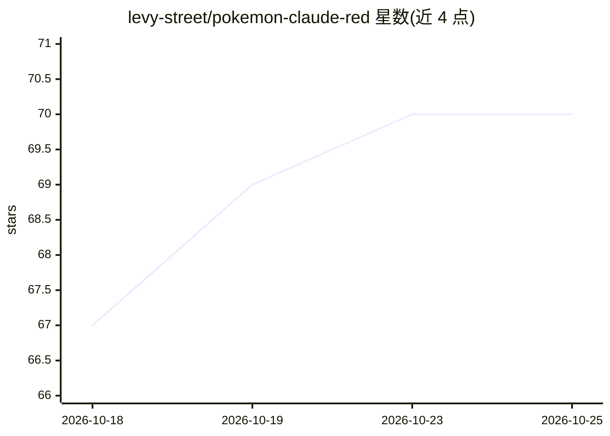

# levy-street/pokemon-claude-red

⭐ 70 · JavaScript · 推送 2026-09-30 · [GitHub](https://github.com/levy-street/pokemon-claude-red) · [官网](https://claudered.dev) · 组织维护

**浏览器里运行的 Pokémon Red 复刻，全部由代码生成像素与音乐**

由 Claude Opus 5.5 在 Claude Code 中生成的 Pokémon Red 非商业粉丝复刻，运行于浏览器，无依赖、无构建步骤、不含任何图片文件。151 只宝可梦、地图瓦片与建筑均由程序化绘图语言（椭圆、多边形等）在运行时光栅化生成；52 首乐曲的音符数据转换自 pret/pokered 反汇编工程。包含完整关都剧情、实时联机对战/交换、Social Zone、每日猜宝可梦问答等功能，可选 Python 服务器提供账号云存档与在线功能。

## 筛选速览

| 维度 | 判定 | 备注 |
|---|---|---|
| AI 角色 | `ai-native` | 本体是模型或模型工具 |
| 许可风险 | `none` | — |
| 部署形态 | `None` |  |
| 模型依赖 | — | README 未给出锁定关系 |
| 硬件要求 | — | 无带数字的原话,不猜 |
| 安装摩擦 | `low` | 无编译、无系统依赖或容器化 |
| 成熟度 | — | 结构信号不足 |

## 能力要点

- 所有精灵、瓦片与战斗特效均由程序化代码绘制，游戏内无图片文件
- 151 只宝可梦由形状描述语言在运行时光栅化为带描边与阴影的像素画
- 包含完整关都剧情：224 张地图、八馆、四天王与约 2500 句对话
- 实时联机对战/交换与 Social Zone 在线房间（经服务器中继）

## 适用场景

- 在浏览器或手机上直接游玩 Pokémon Red 复刻
- 查看程序化像素艺术生成与 Game Boy 音乐序列器实现
- 自托管完整站点以获得账号云存档与联机功能

## 场景标签

 · 领域:游戏/AI 生成内容

## 证据(README 行号)

> L5:  Pokémon Red, rebuilt from raw pixels by Claude Opus 5.5.
> L197: - Built by **Claude Opus 5.5** in Claude Code, directed by

## 星数曲线

2026-10-18 67 → 2026-10-25 70（+3）

---
*卡片 v1 · prompt 1.4 · 生成 2026-10-24 · 置信度 high · 依据 README sha `9f4fc05e4735` · [字段定义](../../DATASET.md)*
