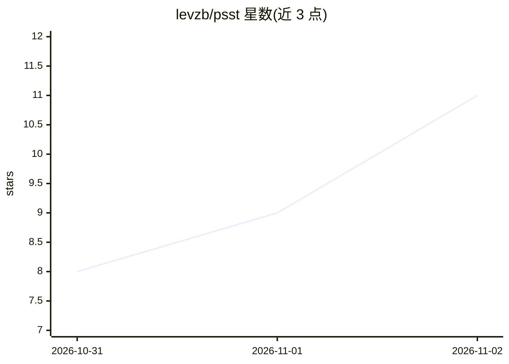

# levzb/psst

⭐ 11 · Python · Unlicense · 推送 2026-10-30 · [GitHub](https://github.com/levzb/psst) · 个人维护

**终端里用自然语言换出一条适配本机的 shell 命令**

面向 shell 用户的 CLI 工具：输入一句任务描述，通过 OpenRouter 免费模型生成一条精确的 shell 命令并填入输入行，不会自动执行。生成前会在本机校验：命令须以 PATH/别名/函数/内建形式存在，语法须通过当前 shell 解析器，flag 会对照本机二进制的 --help/man 查证；失败时把错误与帮助反馈给模型一次再给出带警告的答案。需 OpenRouter 免费 key，支持 zsh/bash/PowerShell/fish 集成，安装提供 curl/irm 脚本或 Releases 二进制。

## 筛选速览

| 维度 | 判定 | 备注 |
|---|---|---|
| AI 角色 | `ai-native` | 本体是模型或模型工具 |
| 许可风险 | `permissive` | Unlicense |
| 部署形态 | `None` |  |
| 模型依赖 | locked-api |  |
| 硬件要求 | — | 无带数字的原话,不猜 |
| 安装摩擦 | `low` | 无编译、无系统依赖或容器化 |
| 成熟度 | — | 结构信号不足 |

## 能力要点

- 生成前按本机二进制/别名/shell 解析器校验命令与 flag
- 结果命令直接落入输入行，不自动执行
- 无参数调用可修复上一条失败命令
- 请求含 OS/shell 版本、PATH、别名、当前目录等信息但不含文件内容

## 适用场景

- 忘记命令时用一句话拿到适配本机（含 BSD/macOS 差异）的命令
- 让工具自动修复刚才失败的命令
- CI 中用 OPENROUTER_API_KEY 环境变量免交互调用

## 场景标签

`代码生成` · 领域:编码与开发

## 证据(README 行号)

> L3: Describe a task in plain words, get one exact shell command for **your** machine and **your** terminal session.
> L8: Before showing a command, psst checks it against your machine. Every program must exist (as a binary on PATH, an ali
> L28: **Key.** psst uses free models on OpenRouter. Get a free key at <https://openrouter.ai/keys> and save it:

## 星数曲线

2026-10-31 8 → 2026-11-02 11（+3）

---
*卡片 v1 · prompt 1.4 · 生成 2026-11-02 · 置信度 high · 依据 README sha `c0fb7514c1d5` · [字段定义](../../DATASET.md)*
