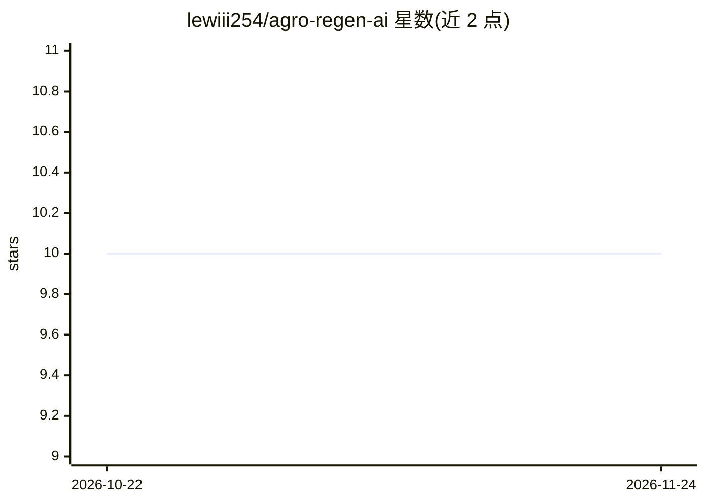

# lewiii254/agro-regen-ai

⭐ 10 · TypeScript · 推送 2026-05-25 · [GitHub](https://github.com/lewiii254/agro-regen-ai) · [官网](https://agro-regen-ai.vercel.app) · 个人维护

**面向农民的气候智慧型再生农业 AI 全栈平台**

React + TypeScript + Supabase 构建的全栈 Web 应用，面向农民提供土壤健康监测与 AI 改良建议、产量预测、灌溉排程、病虫害检测、市场价格追踪、气候预警、AI 农事问答（Gemini）、学习资源、社区互动、农场地图与土地修复项目投资对接等模块。安装需 Node.js v18+ 与 npm/bun，通过 git clone 后 npm install 并配置 Supabase 环境变量运行开发服务器；环境变量由 Lovable Cloud 自动配置。README 未给出测试或部署说明。

## 筛选速览

| 维度 | 判定 | 备注 |
|---|---|---|
| AI 角色 | `ai-native` | 本体是模型或模型工具 |
| 许可风险 | `none` | — |
| 部署形态 | `self-host` | docker 或自建部署 |
| 模型依赖 | — | README 未给出锁定关系 |
| 硬件要求 | — | 无带数字的原话,不猜 |
| 安装摩擦 | `low` | 无编译、无系统依赖或容器化 |
| 成熟度 | — | 结构信号不足 |

## 能力要点

- AI 土壤分析：pH/氮磷钾/水分追踪与健康评分
- 基于机器学习的产量预测（含置信度）
- Google Gemini 驱动的多语言农事问答机器人
- 土地修复项目投资市场与社区/学习中心

## 适用场景

- 监测农田土壤养分并获取改良与轮作建议
- 预测气候风险并接收农事预警
- 管理灌溉排程与产量/收获计划
- 浏览并投资土地修复项目

## 场景标签

 · 领域:农业/气候科技

## 证据(README 行号)

> L20: **AgroReGen** is a revolutionary full-stack web application designed to help farmers transition to climate-smart, r
> L190:  - Powered by Google Gemini AI
> L280:  - Google Gemini 2.5 Flash

## 星数曲线

2026-10-22 10 → 2026-11-24 10（+0）

---
*卡片 v1 · prompt 1.4 · 生成 2026-11-19 · 置信度 mid · 依据 README sha `baab4c932c1b` · [字段定义](../../DATASET.md)*
