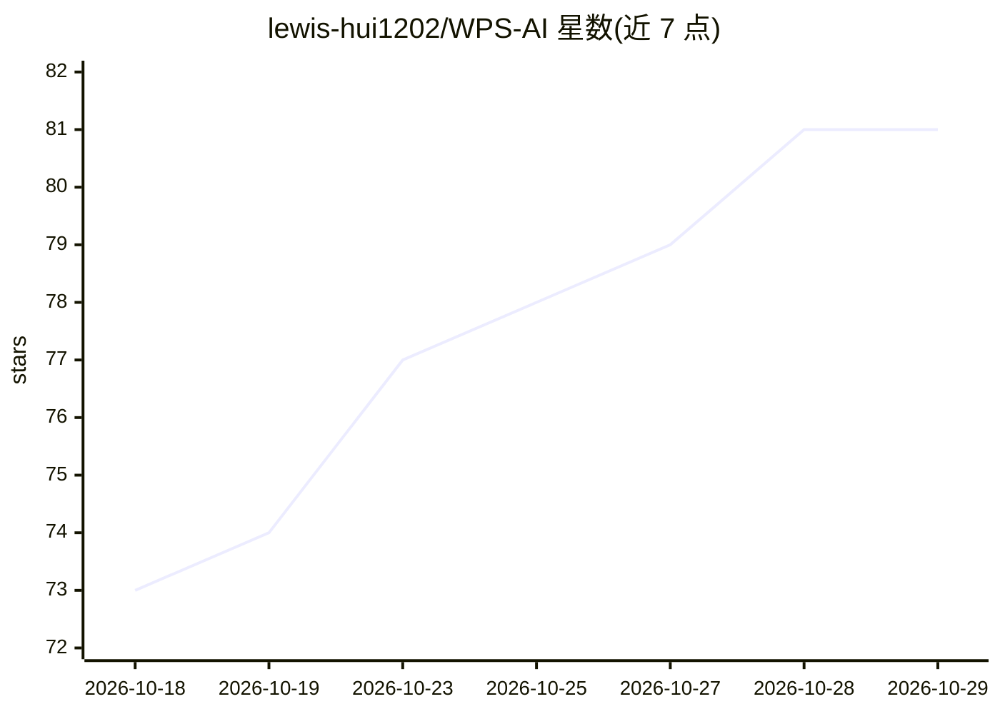

# lewis-hui1202/WPS-AI

⭐ 81 · JavaScript · MIT · 推送 2026-08-11 · [GitHub](https://github.com/lewis-hui1202/WPS-AI) · [官网](https://wps-ai.llteac.cn/) · 个人维护 · 中文 README

**WPS Office 四端（文字/表格/演示/PDF）统一 AI 助手插件**

WPS 桌面客户端的 TaskPane 加载项：文字/表格/演示/PDF 四宿主共用一套面板，AI 通过工具调用与 JSAPI 直接读写文档，含预览确认与直接写入两档安全模式。接入 Codex OAuth / OpenAI / Anthropic / Gemini / Azure / OpenAI 兼容及本地 Ollama 等 15 条预设，可同时挂多家切换。功能含双向 MCP、生图、markdown 转 Word 原生格式、大纲生成 PPT、PDF 对照翻译等。Windows/macOS/Linux 提供内置 Node 运行时的安装包；仅支持桌面客户端，WPS 26884+ 版本存在兼容问题待修复。

## 筛选速览

| 维度 | 判定 | 备注 |
|---|---|---|
| AI 角色 | `ai-native` | 本体是模型或模型工具 |
| 许可风险 | `permissive` | MIT |
| 部署形态 | `desktop` | 安装包/桌面程序 |
| 模型依赖 | local-ok | 支持本地模型 |
| 硬件要求 | — | 无带数字的原话,不猜 |
| 安装摩擦 | `low` | 无编译、无系统依赖或容器化 |
| 成熟度 | — | 结构信号不足 |

## 能力要点

- AI 通过工具调用直接读写四端文档，预览确认/直接写入两档安全
- 6 类协议原生适配 + 15 条 provider 预设，可同时挂多家随时切
- 双向 MCP：作为 Server 暴露 WPS 工具，作为 Client 接入外部 MCP 服务
- AI 工作期间硬锁文档、per-turn 备份一键回退、改动记录 Tab

## 适用场景

- 在 WPS 里让 AI 直接写作、润色、翻译、总结文档
- AI 生成公式、美化表格、大纲生成 PPT 并可视化编辑
- 把 WPS 文档操作暴露给 Claude Code / Cursor 等外部 agent 调用

## 场景标签

`AI 助手` `图像生成` `AI 写作` · 领域:对话与助手

## 证据(README 行号)

> L3:  一个 TaskPane 兼容 WPS 文字 / 表格 / 演示 / PDF 四端的 AI 助手，挂多家 AI（Codex / OpenAI / Anthropic / Gemini / Azure / OpenAI 兼容），AI 
> L24: |文字 / 表格 / 演示 / PDF 四端共用一套 TaskPane，宿主自动分发|Codex / OpenAI / Anthropic / Gemini / Azure / OpenAI Responses + 本地 Olla

## 星数曲线

2026-10-18 73 → 2026-10-29 81（+8）

---
*卡片 v1 · prompt 1.4 · 生成 2026-10-24 · 置信度 mid · 依据 README sha `5bb6257552a4` · [字段定义](../../DATASET.md)*
