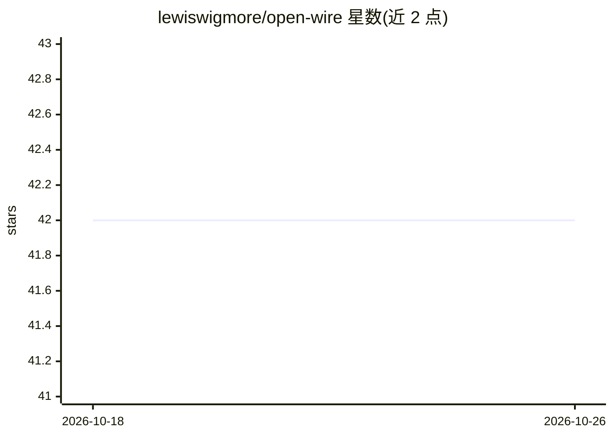

# lewiswigmore/open-wire

⭐ 42 · TypeScript · MIT · 推送 2026-10-25 · [GitHub](https://github.com/lewiswigmore/open-wire) · [官网](https://marketplace.visualstudio.com/items?itemName=lewiswigmore.open-wire) · 个人维护

**把 VS Code 内可见的语言模型暴露为 OpenAI 兼容 REST API 的扩展**

VS Code 扩展，在本机 127.0.0.1:3030 启动一个 OpenAI 兼容的 HTTP 服务：自动发现所有注册到 VS Code Language Model API 的模型（Claude、GPT、Gemini、经扩展注册的 Ollama 等），以 /v1/chat/completions、/v1/models 等端点对外提供，支持 SSE 流式输出、工具调用转发、图像输入与服务器端强制 JSON 模式（含 schema 校验与修复重试）。请求参数分四个桶处理：执行、转发、拒绝或报告，不静默忽略。默认启用 Bearer token 认证、限速与仅回环的 CORS。面向希望通过标准 OpenAI API 调用这些模型的开发者与 agent 工具链，可注册为 OpenClaw 的自定义 provider。

## 筛选速览

| 维度 | 判定 | 备注 |
|---|---|---|
| AI 角色 | `ai-ecosystem` | LLM/agent 周边工具 |
| 许可风险 | `permissive` | MIT |
| 部署形态 | `library` | 以包/库形式分发 |
| 模型依赖 | local-ok | 支持本地模型 |
| 硬件要求 | — | 无带数字的原话,不猜 |
| 安装摩擦 | `low` | 无编译、无系统依赖或容器化 |
| 成熟度 | — | 结构信号不足 |

## 能力要点

- 自动发现并暴露所有 VS Code Language Model API 注册的模型
- /v1/chat/completions 与 /v1/models，支持 SSE 流式、工具调用转发与图像输入
- 服务器端强制 JSON 模式：严格指令、JSON 恢复、schema 校验与一次修复重试
- 参数四桶处理（执行/转发/拒绝/报告），GET /v1/capabilities 声明支持范围

## 适用场景

- 用标准 OpenAI 客户端调用 VS Code 内已登录的 Copilot 模型
- 为 OpenClaw 等 agent 框架注册一个本地 OpenAI 兼容 provider
- 在本地脚本中统一访问 Claude/GPT/Gemini 等多家模型

## 场景标签

`模型网关` · 领域:Agent 开发

## 证据(README 行号)

> L3: Expose VS Code language models as an **OpenAI-compatible REST API** on localhost.
> L19: - **OpenAI-compatible.** `/v1/chat/completions` and `/v1/models`, with SSE streaming.

## 星数曲线

2026-10-18 42 → 2026-10-26 42（+0）

---
*卡片 v1 · prompt 1.4 · 生成 2026-10-25 · 置信度 high · 依据 README sha `1f2703afe5a6` · [字段定义](../../DATASET.md)*
