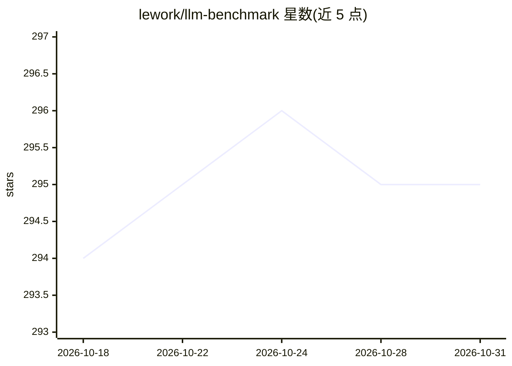

# lework/llm-benchmark

⭐ 295 · Python · MIT · 推送 2025-12-10 · [GitHub](https://github.com/lework/llm-benchmark) · 个人维护 · 中文 README

**LLM 服务并发压测工具：多阶段压力测试与性能报告**

面向 LLM 服务器（OpenAI 兼容 API 形式的 URL/key/model 参数）的并发性能测试工具。run_benchmarks.py 执行多轮自动化压测，并发范围 1-300 逐步提升，自动收集汇总数据并生成可视化报告；llm_benchmark.py 提供核心并发测试逻辑，管理并发请求与连接池，支持流式响应与长文本场景，输出 JSON 格式结果。提供 pip 依赖安装、源码运行与 Docker 两种运行方式。

## 筛选速览

| 维度 | 判定 | 备注 |
|---|---|---|
| AI 角色 | `ai-ecosystem` | LLM/agent 周边工具 |
| 许可风险 | `permissive` | MIT |
| 部署形态 | `self-host` | docker 或自建部署 |
| 模型依赖 | — | README 未给出锁定关系 |
| 硬件要求 | — | 无带数字的原话,不猜 |
| 安装摩擦 | `low` | 无编译、无系统依赖或容器化 |
| 成熟度 | — | 结构信号不足 |

## 能力要点

- 多阶段并发测试，自动调整 1-300 并发
- 支持流式响应与长文本测试场景
- 生成可视化性能报告与 JSON 输出
- 提供 Docker 镜像与本地源码两种运行方式

## 适用场景

- 压测自建 LLM 推理服务的并发承载能力
- 对比不同并发下的吞吐与延迟指标
- 为选型评估生成可留档的性能报告

## 场景标签

 · 领域:LLM 基础设施/性能评测

## 证据(README 行号)

> L3: LLM 并发性能测试工具，支持自动化压力测试和性能报告生成。
> L28:  - 执行多轮自动化压力测试
> L29:  - 自动调整并发配置（1-300 并发）

## 星数曲线

2026-10-18 294 → 2026-10-31 295（+1）

---
*卡片 v1 · prompt 1.4 · 生成 2026-10-21 · 置信度 high · 依据 README sha `13299766f567` · [字段定义](../../DATASET.md)*
