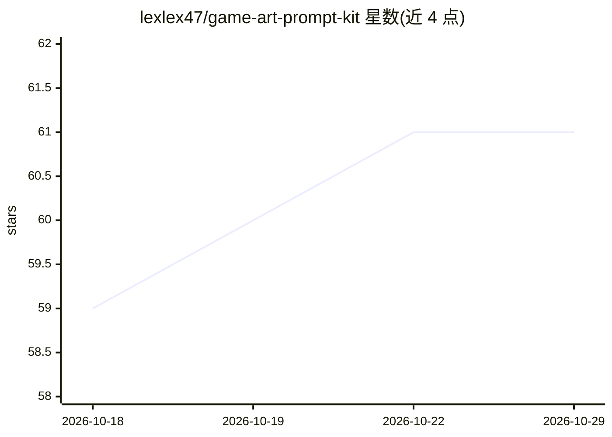

# lexlex47/game-art-prompt-kit

⭐ 61 · MIT · 推送 2026-06-16 · [GitHub](https://github.com/lexlex47/game-art-prompt-kit) · 个人维护 · 中文 README

**游戏美术提示词模板库：像素精灵图/角色概念/2D 环境生成**

以 Markdown 文件形式组织的可复用提示词（prompt）档案库，面向使用图像生成模型制作游戏美术素材的开发者与创作者：共 14 个模板，覆盖像素精灵图（含多方向跑动循环、动作网格）、角色概念设定、俯视像素场景与横版视差环境等；每个档案说明用途、适用输入与用法模式（纯文生图/参考图引导/混合），可复制到主流图像模型或 ComfyUI、Stable Diffusion 等本地工作流。提供中英双语档案与每个模板的预览图。

## 筛选速览

| 维度 | 判定 | 备注 |
|---|---|---|
| AI 角色 | `ai-knowledge` | 知识聚合/清单类 |
| 许可风险 | `permissive` | MIT |
| 部署形态 | `None` |  |
| 模型依赖 | — | README 未给出锁定关系 |
| 硬件要求 | — | 无带数字的原话,不猜 |
| 安装摩擦 | `low` | 无编译、无系统依赖或容器化 |
| 成熟度 | — | 结构信号不足 |

## 能力要点

- 14 个提示词档案，覆盖精灵图、动画表、角色概念与 2D 环境
- 三种用法模式标注：文生图/参考图引导/混合
- 英文与简体中文双语档案，每个模板附预览图
- 自包含 Markdown 文件，可直接复制、修改与版本管理

## 适用场景

- 为独立游戏生成像素风精灵图与动画表
- 制作角色概念设定图与俯视/横版场景素材
- 在 ComfyUI 或 Stable Diffusion 本地工作流中复用提示词模板

## 场景标签

`提示工程` · 领域:Agent 开发

## 证据(README 行号)

> L7: The library is organized as practical Markdown profiles. Each profile describes what it is for, when to use it, what
> L13: - 14 prompt profiles covering pixel spritesheets, creature animation sheets, character concept art, topdown maps, s

## 星数曲线

2026-10-18 59 → 2026-10-29 61（+2）

---
*卡片 v1 · prompt 1.4 · 生成 2026-10-24 · 置信度 high · 依据 README sha `79808b116391` · [字段定义](../../DATASET.md)*
