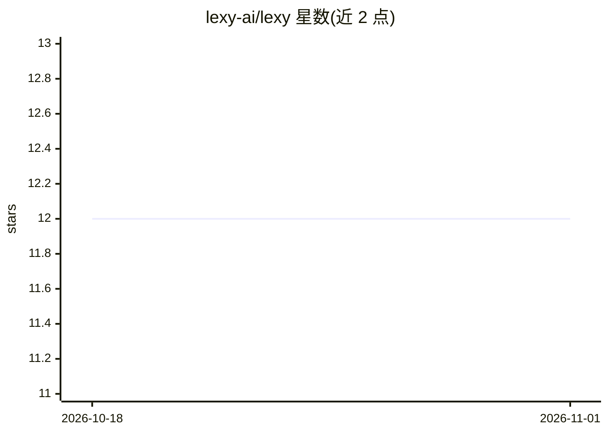

# lexy-ai/lexy

⭐ 12 · Python · Apache-2.0 · 推送 2026-10-05 · [GitHub](https://github.com/lexy-ai/lexy) · [官网](https://getlexy.com) · 组织维护

**为 AI 应用提供数据管道与存储的平台（RAG/记忆/结构化提取）**

面向构建 AI 应用的数据平台：以 RESTful API 服务器、Celery worker、RabbitMQ 与 Postgres 组成的服务栈，提供文档存取、transformations、collections 与索引管理，可用于 RAG、agent 上下文、聊天长期记忆与非结构化文档的结构化提取。文件存储需配置 Amazon S3 或 Google Cloud Storage，嵌入支持 OpenAI（设 OPENAI_API_KEY）。本地运行依赖 Docker 与 Python 3.11+，可源码构建（docker compose）或从 PyPI 以 standalone 模式安装；提供 Python SDK（lexy-py）与开发中的可视化 dashboard（需 Node.js/npm）。

## 筛选速览

| 维度 | 判定 | 备注 |
|---|---|---|
| AI 角色 | `ai-ecosystem` | LLM/agent 周边工具 |
| 许可风险 | `permissive` | Apache-2.0 |
| 部署形态 | `self-host` | docker 或自建部署 |
| 模型依赖 | — | README 未给出锁定关系 |
| 硬件要求 | — | 无带数字的原话,不猜 |
| 安装摩擦 | `low` | 无编译、无系统依赖或容器化 |
| 成熟度 | `idea` | |

## 能力要点

- REST API 管理文档、transformations、collections 与索引
- Python SDK（lexy-py）的 LexyClient 交互接口
- 文件存储支持 Amazon S3 与 Google Cloud Storage
- 内置 dashboard 可视化管道（WIP），附 Flower/Celery 任务监控

## 适用场景

- 为 RAG 应用存储与检索文档和嵌入
- 给 AI agent 或聊天应用提供相关上下文与长期记忆
- 从非结构化文档中提取结构化数据

## 场景标签

`RAG` `Agent 记忆` · 领域:Agent 开发

## 证据(README 行号)

> L3: Lexy is a data platform for building AI-powered applications. You can use Lexy to:
> L5: - Build Retrieval Augmented Generation (RAG) applications.
> L6: - Provide relevant context for AI agents.
> L136: The Lexy server is a RESTful API that provides endpoints for storing and retrieving documents, applying

## 星数曲线

2026-10-18 12 → 2026-11-01 12（+0）

---
*卡片 v1 · prompt 1.4 · 生成 2026-11-01 · 置信度 mid · 依据 README sha `ecfa4144b395` · [字段定义](../../DATASET.md)*
