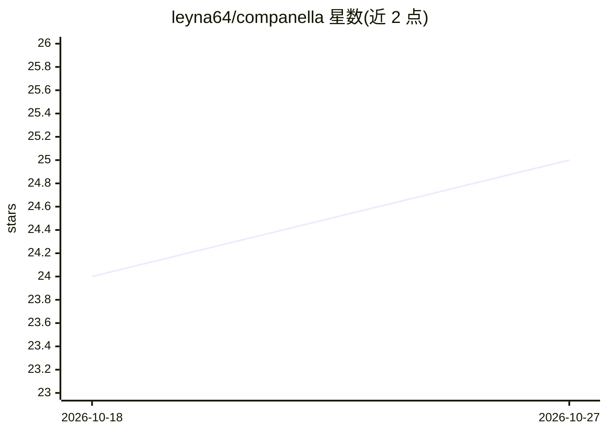

# leyna64/companella

⭐ 25 · C# · NOASSERTION · 推送 2026-10-05 · [GitHub](https://github.com/leyna64/companella) · [官网](https://erdbee.re) · 个人维护

**osu!mania 玩家与谱师的练习辅助桌面工具**

面向 osu!mania 玩家和谱面制作者的 Windows 桌面伴侣程序：对本地谱面库建立 MSD 难度与 pattern 索引，基于会话数据生成个性化练习谱面推荐与训练计划，追踪 8 项技能集趋势；另提供变速谱生成、马拉松谱合成（含背景合成与 glitch 特效）、Dan 段位训练、BPM/SV/Offset 等制谱工具及游戏内覆盖层。通过安装包分发，自动连接 osu!；Dan 评级功能附有实验性声明。

## 筛选速览

| 维度 | 判定 | 备注 |
|---|---|---|
| AI 角色 | `ai-enhanced` | 去掉 AI 部分产品仍成立 |
| 许可风险 | `none` | NOASSERTION |
| 部署形态 | `None` |  |
| 模型依赖 | — | README 未给出锁定关系 |
| 硬件要求 | — | 无带数字的原话,不猜 |
| 安装摩擦 | `medium` | 含编译或系统依赖之一 |
| 成熟度 | — | 结构信号不足 |

## 能力要点

- 基于 MinaCalc MSD 的本地谱面索引与个性化推荐（Push/Consistency/Deficit Fixing 等模式）
- 单人/批量变速谱生成与马拉松谱合成（含复合背景与 glitch 特效）
- 8 项技能集趋势分析与实时会话追踪
- BPM 音频分析、SV 标准化、Offset 调整等制谱工具

## 适用场景

- 我想追踪自己的 osu!mania 技能进步并找出弱项
- 我想让工具根据当前水平推荐练习谱并生成训练计划
- 我想批量生成变速谱或把多张谱合成马拉松图

## 场景标签

 · 领域:游戏/桌面工具

## 证据(README 行号)

> L31: A powerful companion tool for osu!mania players and mappers. Track your progress, get personalized practice recomme
> L134: Get personalized beatmap recommendations based on your current skill level and goals.

## 星数曲线

2026-10-18 24 → 2026-10-27 25（+1）

---
*卡片 v1 · prompt 1.4 · 生成 2026-10-27 · 置信度 mid · 依据 README sha `150e6f2f0def` · [字段定义](../../DATASET.md)*
