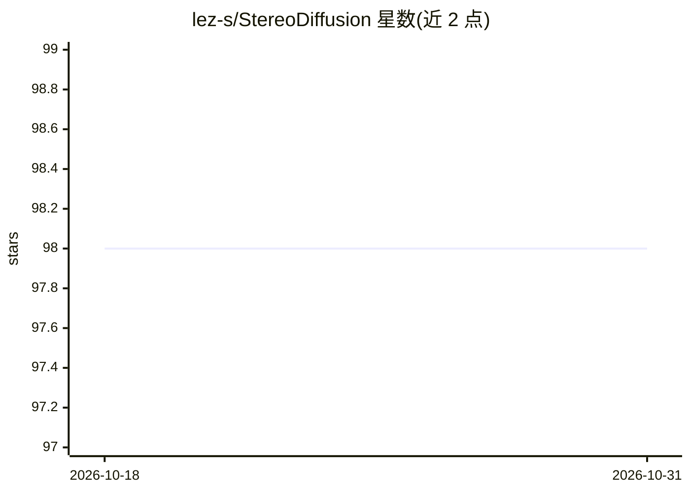

# lez-s/StereoDiffusion

⭐ 98 · Python · MIT · 推送 2025-12-25 · [GitHub](https://github.com/lez-s/StereoDiffusion) · [官网](https://arxiv.org/abs/2403.04965) · 个人维护

**基于 Stable Diffusion 的免训练立体图像对生成方法**

StereoDiffusion 是一篇 CVPR 论文的官方实现：在原始 Stable Diffusion 模型上免训练生成左右立体图像对。机制为先生成左图并估计视差图，通过 Stereo Pixel Shift 构造右图 latent，配合 Symmetric Pixel Shift Masking Denoise 与 Self-Attention 层修改对齐两侧图像，无需微调权重或图像后处理。提供文本生成立体图、深度图生成立体图、已有图像转立体图三种用法，以 notebook 与 Python 脚本运行。需 Linux、Python 3.8、CUDA 12.0，需自行下载 Stable Diffusion 与 DPT 深度模型。

## 筛选速览

| 维度 | 判定 | 备注 |
|---|---|---|
| AI 角色 | `ai-native` | 本体是模型或模型工具 |
| 许可风险 | `permissive` | MIT |
| 部署形态 | `library` | 以包/库形式分发 |
| 模型依赖 | — | README 未给出锁定关系 |
| 硬件要求 | — | 无带数字的原话,不猜 |
| 安装摩擦 | `medium` | 含编译或系统依赖之一 |
| 成熟度 | — | 结构信号不足 |

## 能力要点

- 免训练、无需微调权重与图像后处理即可生成立体图像对
- Stereo Pixel Shift + Symmetric Pixel Shift Masking Denoise + Self-Attention 层修改
- 支持文本、深度图、已有图像三种输入生成立体图

## 适用场景

- 为 XR 设备内容快速生成立体图像对
- 从单张已有图像生成立体版本
- 从文本提示词直接生成左右立体图

## 场景标签

`图像生成` · 领域:内容生成

## 证据(README 行号)

> L1: # StereoDiffusion: Training-Free Stereo Image Generation Using Latent Diffusion Models
> L7: The demand for stereo images increases as manufacturers launch more XR devices. To meet this demand, we introduce St

## 星数曲线

2026-10-18 98 → 2026-10-31 98（+0）

---
*卡片 v1 · prompt 1.4 · 生成 2026-10-23 · 置信度 mid · 依据 README sha `6912711c5417` · [字段定义](../../DATASET.md)*
