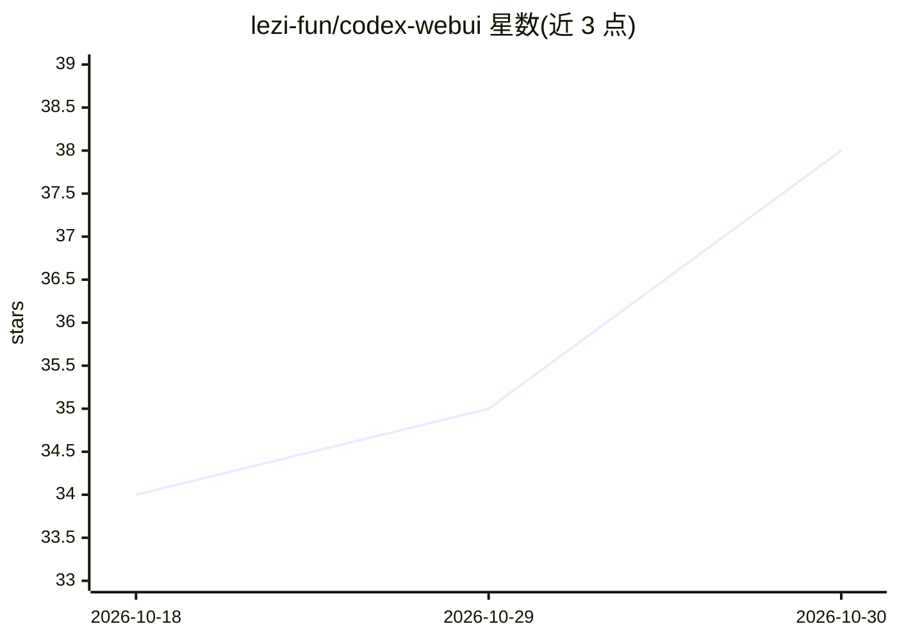

# lezi-fun/codex-webui

⭐ 38 · JavaScript · MIT · 推送 2026-10-20 · [GitHub](https://github.com/lezi-fun/codex-webui) · 个人维护 · 中文 README

**非官方的本地/局域网 Codex app-server WebUI**

连接本机 codex app-server --stdio 进程并通过浏览器界面暴露 Codex 体验的社区项目：保留真实会话、模型目录、流式回复、工具活动、命令/文件/权限审批、diff 审查（含 Git Undo/Reapply）与 token 用量，不做静态模拟。默认仅绑定 localhost，局域网访问需密码或访问令牌认证。面向已安装并登录 Codex CLI 的开发者，需 Bun 1.3+、Node 20+ 与 Git；提供 git clone 源码运行与 Docker Compose 部署两种方式，macOS/Linux 为推荐平台。

## 筛选速览

| 维度 | 判定 | 备注 |
|---|---|---|
| AI 角色 | `ai-ecosystem` | LLM/agent 周边工具 |
| 许可风险 | `permissive` | MIT |
| 部署形态 | `self-host` | docker 或自建部署 |
| 模型依赖 | — | README 未给出锁定关系 |
| 硬件要求 | — | 无带数字的原话,不猜 |
| 安装摩擦 | `low` | 无编译、无系统依赖或容器化 |
| 成熟度 | — | 结构信号不足 |

## 能力要点

- WebSocket 桥接真实 codex app-server，保留线程/流式回复/审批/token 用量
- 命令、文件变更、网络与权限审批界面，含 Allow once / Allow similar 等作用域
- 统一与分栏 diff 审查，Git-backed Undo/Reapply
- 默认 localhost-only，局域网访问需 scrypt 密码或访问令牌

## 适用场景

- 在浏览器或手机上操作本地 Codex agent 会话
- 在局域网内经认证后远程使用 Codex 审批与 diff 审查
- 用 Docker Compose 做本地容器化部署

## 场景标签

`编码 Agent` · 领域:编码与开发

## 证据(README 行号)

> L3:  A local, LAN-accessible WebUI for the real Codex app-server.
> L17: Codex WebUI connects directly to `codex app-server --stdio` and exposes the local Codex experience through a respon

## 星数曲线

2026-10-18 34 → 2026-10-30 38（+4）

---
*卡片 v1 · prompt 1.4 · 生成 2026-10-25 · 置信度 mid · 依据 README sha `82850cee8ce2` · [字段定义](../../DATASET.md)*
