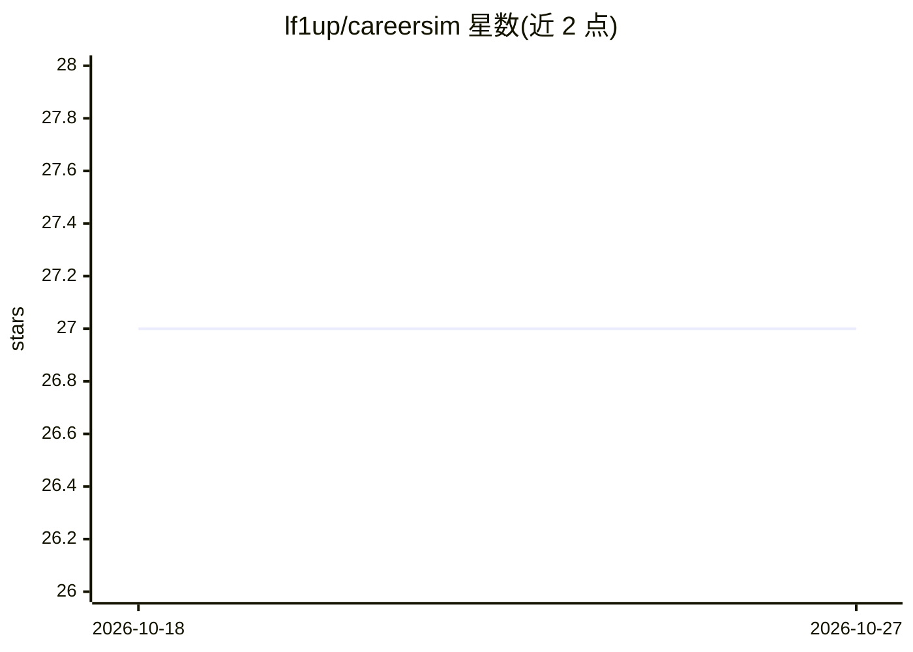

# lf1up/careersim

⭐ 27 · TypeScript · MIT · 推送 2026-10-26 · [GitHub](https://github.com/lf1up/careersim) · [官网](https://careersim.ai) · 个人维护

**面向个人的 AI 职场技能模拟器：练习面试与谈判并获反馈**

B2C Web 应用，用 LangGraph 生成式 AI 引擎模拟行为面试、艰难对话等职业场景，用户与多样化 AI 人设进行对话练习并获得基于 LLM 评估的即时反馈。架构为微服务：Next.js 前端、Fastify API（持有状态）、Python/FastAPI 无状态对话引擎（内嵌 Chroma 检索），语音模式经自托管 LiveKit SFU 与 agent-voice 工作进程（faster-whisper STT / Piper TTS）复用同一引擎。含 9 个一方模拟场景；仓库处于迁移中，backend/frontend/rag/transformers 四个旧服务已标弃用仅作参考。Docker Compose 一键启动。

## 筛选速览

| 维度 | 判定 | 备注 |
|---|---|---|
| AI 角色 | `ai-native` | 本体是模型或模型工具 |
| 许可风险 | `permissive` | MIT |
| 部署形态 | `self-host` | docker 或自建部署 |
| 模型依赖 | — | README 未给出锁定关系 |
| 硬件要求 | — | 无带数字的原话,不猜 |
| 安装摩擦 | `low` | 无编译、无系统依赖或容器化 |
| 成熟度 | — | 结构信号不足 |

## 能力要点

- LangGraph 对话引擎：生成人设回复并做 LLM 评估（情绪/目标进度）
- 浏览器原生语音模式：LiveKit SFU + faster-whisper/Piper，与文本路径共用引擎
- 主动消息机制：开场白、跟进消息突发、不活跃提醒（拉模式）
- 9 个带隐藏目标与成功标准的模拟场景

## 适用场景

- 在可重复的安全环境中练习行为面试和艰难对话
- 通过语音或文字与 AI 人设对话并获得即时评估反馈
- 自托管运行完整的模拟平台（含博客 CMS）

## 场景标签

`聊天机器人` · 领域:对话与助手

## 证据(README 行号)

> L8: **CareerSIM** is a direct-to-consumer (B2C) web application that helps individuals master critical career skills thr
> L10: The platform empowers users to build confidence and competence for career-defining moments. By leveraging a LangGra
> L40: |**agent**|Python 3.11+, FastAPI, LangGraph, Chroma (embedded), OpenAI / OpenRouter|Stateless conversation engine. 

## 星数曲线

2026-10-18 27 → 2026-10-27 27（+0）

---
*卡片 v1 · prompt 1.4 · 生成 2026-10-26 · 置信度 high · 依据 README sha `1686b97fc916` · [字段定义](../../DATASET.md)*
