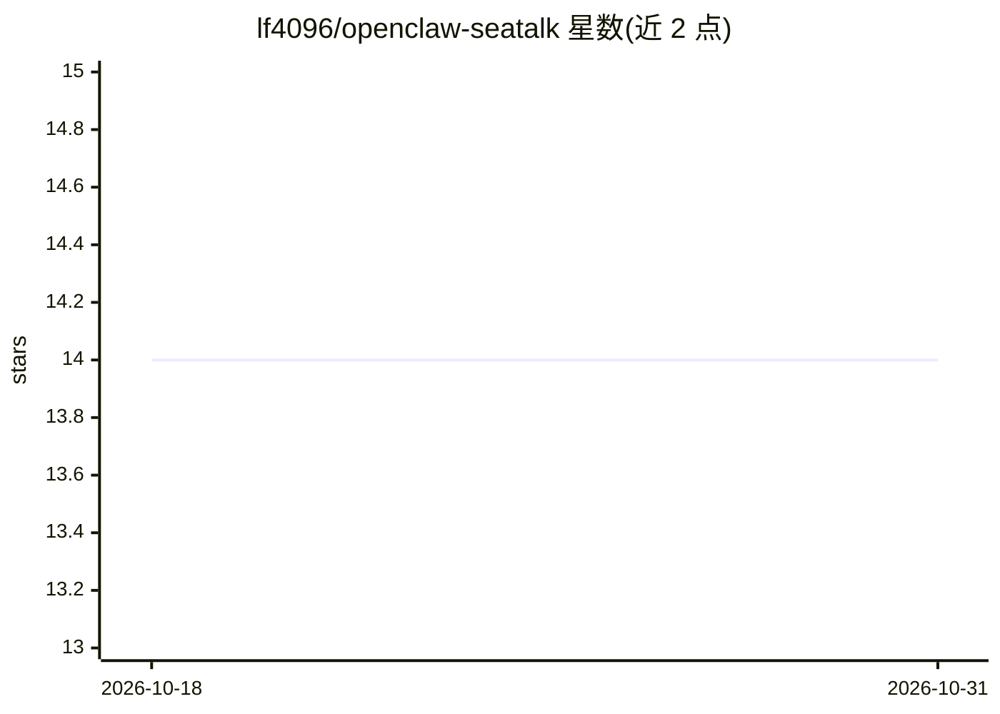

# lf4096/openclaw-seatalk

⭐ 14 · TypeScript · Apache-2.0 · 推送 2026-10-07 · [GitHub](https://github.com/lf4096/openclaw-seatalk) · 个人维护

**将 OpenClaw AI 代理接入 SeaTalk 的渠道插件**

TypeScript 编写的 OpenClaw 渠道插件，把 OpenClaw 代理接入 SeaTalk 消息平台：支持私聊/群聊双向收发文本、图片与文件，每个会话线程作为独立 agent 会话并继承父级转录。提供 webhook、官方 WebSocket、relay 三种网关模式，内置 SHA256 签名校验、令牌自动刷新、出站消息合并（4000 字符分块）、事件去重与多级访问控制。注册 seatalk agent 工具供代理查询群历史/群信息/线程消息。通过 openclaw plugins install 安装，需预先在 SeaTalk 开放平台创建 Bot App 并配置权限。

## 筛选速览

| 维度 | 判定 | 备注 |
|---|---|---|
| AI 角色 | `ai-ecosystem` | LLM/agent 周边工具 |
| 许可风险 | `permissive` | Apache-2.0 |
| 部署形态 | `library` | 以包/库形式分发 |
| 模型依赖 | — | README 未给出锁定关系 |
| 硬件要求 | — | 无带数字的原话,不猜 |
| 安装摩擦 | `low` | 无编译、无系统依赖或容器化 |
| 成熟度 | — | 结构信号不足 |

## 能力要点

- 私聊/群聊双向消息，线程级隔离 agent 会话并继承父级转录
- webhook/官方 WebSocket/relay 三种网关模式
- SHA256 签名校验、令牌自动刷新、事件去重与出站消息合并
- 注册 5 个 seatalk agent 工具（群历史/群信息/群列表/线程历史/取消息）

## 适用场景

- 让 OpenClaw 代理在 SeaTalk 上以机器人形式回答员工提问
- 在群聊中 @机器人触发代理处理并回复
- 通过邮件解析员工编号定向发送消息

## 场景标签

 · 领域:消息平台/Agent 集成

## 证据(README 行号)

> L3: OpenClaw channel plugin for SeaTalk messaging.
> L11: - **Thread messages** — each DM or group thread runs as an isolated agent session that inherits the parent transcri

## 星数曲线

2026-10-18 14 → 2026-10-31 14（+0）

---
*卡片 v1 · prompt 1.4 · 生成 2026-10-31 · 置信度 high · 依据 README sha `367fa998d7bb` · [字段定义](../../DATASET.md)*
