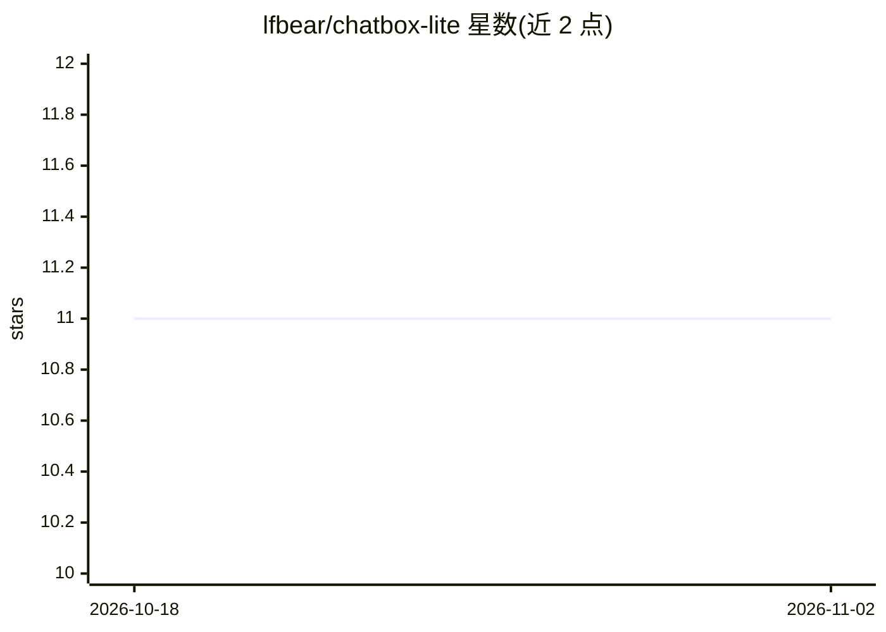

# lfbear/chatbox-lite

⭐ 11 · HTML · 推送 2026-08-21 · [GitHub](https://github.com/lfbear/chatbox-lite) · [官网](https://lfbear.github.io/chatbox-lite/) · 个人维护 · 中文 README

**单文件浏览器多模型聊天页：直连各 LLM API 免后端聊天**

整个应用是一个 HTML 文件，双击即可在浏览器中运行，零依赖、零后端、零安装。支持 OpenAI 兼容端点（DeepSeek/Moonshot/SiliconFlow/OpenRouter/vLLM 等）、Anthropic Claude、Google Gemini 以及本地 Ollama/llama.cpp/LM Studio；提供流式输出、思维链展示、视觉与文件输入、场景聊天与自动记忆压缩。数据仅存于浏览器 localStorage，不上传第三方服务器；可经静态服务器托管并可选装为 PWA 离线应用。

## 筛选速览

| 维度 | 判定 | 备注 |
|---|---|---|
| AI 角色 | `ai-ecosystem` | LLM/agent 周边工具 |
| 许可风险 | `none` | — |
| 部署形态 | `None` |  |
| 模型依赖 | local-ok | 支持本地模型 |
| 硬件要求 | — | 无带数字的原话,不猜 |
| 安装摩擦 | `low` | 无编译、无系统依赖或容器化 |
| 成熟度 | — | 结构信号不足 |

## 能力要点

- 单 HTML 文件即全应用，零依赖零后端，数据只存 localStorage
- 统一 UI 接入 OpenAI 兼容端点、Claude、Gemini 与本地 Ollama/llama.cpp/LM Studio
- 流式输出与多格式思维链展示（reasoning_content/thinking/<think> 等）
- 场景聊天自动压缩长期记忆，保留最多 10 个历史版本可回滚

## 适用场景

- 本地打开一个文件就能与多家 LLM 服务商聊天
- 配合本地 Ollama/llama.cpp 做纯本地推理前端
- 翻译、角色扮演、语言练习等需要持久人设与记忆的对话
- 部署为静态页面并安装为离线 PWA 应用

## 场景标签

`聊天机器人` · 领域:对话与助手

## 证据(README 行号)

> L3: > A **single-file** browser-based multi-model chat page — double-click the HTML and it just works.
> L9: - **Unified UI across providers**: OpenAI compatible (DeepSeek / Moonshot / SiliconFlow / OpenRouter / vLLM …), Anth
> L104: |Ollama|`http://localhost:11434`|(can be empty)|

## 星数曲线

2026-10-18 11 → 2026-11-02 11（+0）

---
*卡片 v1 · prompt 1.4 · 生成 2026-11-02 · 置信度 high · 依据 README sha `d56c50aaf9f8` · [字段定义](../../DATASET.md)*
