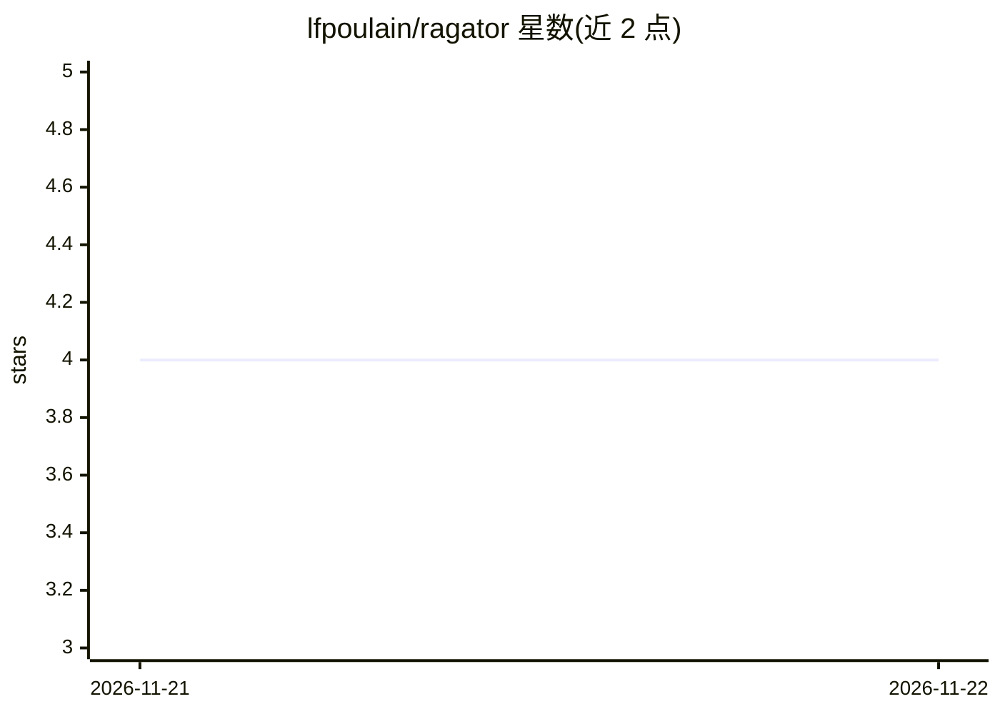

# lfpoulain/ragator

⭐ 4 · TypeScript · MIT · 推送 2026-11-19 · [GitHub](https://github.com/lfpoulain/ragator) · 个人维护

**对 YouTube 频道问答并给出精确时间戳引用**

Ragator 对一个或多个 YouTube 频道的转写文本与视觉描述建立索引（BM25 + 向量，PostgreSQL 17 + ParadeDB），用自然语言提问后回答并逐句附上视频时间戳引用；视频中无答案时直接说明而非编造。提供本地推理（Qwen、Aplomb 判定模型、pplx-embed 经 llama.cpp，需 NVIDIA 16GB 显存）与 OpenRouter 云端两种模式，可随时切换且共用同一索引；经 Docker Compose 部署，含 Web 界面、CLI 与 MCP 服务器。视频文件需先用配套工具 yt2md 生成 JSON。

## 筛选速览

| 维度 | 判定 | 备注 |
|---|---|---|
| AI 角色 | `ai-native` | 本体是模型或模型工具 |
| 许可风险 | `permissive` | MIT |
| 部署形态 | `self-host` | docker 或自建部署 |
| 模型依赖 | local-ok | 支持本地模型 |
| 硬件要求 | — | 无带数字的原话,不猜 |
| 安装摩擦 | `low` | 无编译、无系统依赖或容器化 |
| 成熟度 | — | 结构信号不足 |

## 能力要点

- 回答逐句引用视频时间戳并由代码验证，无答案时明确说明
- 混合检索：BM25 精确词匹配 + 向量语义匹配
- 本地推理（llama.cpp + Qwen）与 OpenRouter 模式共用同一向量索引，一键切换
- Web 界面、CLI 与 MCP 服务器三种访问方式

## 适用场景

- 向自己关注的 YouTube 频道提问并直达视频出处
- 统计频道中所有提到某主题的视频
- 在本地离线处理视频转写数据保护隐私

## 场景标签

`RAG` · 领域:知识与检索

## 证据(README 行号)

> L11:  Posez vos questions à une chaîne YouTube, et obtenez la réponse avec l'instant exact de la vidéo qui la prouve.
> L13: Ragator indexe les transcriptions et les descriptions visuelles des vidéos d'une ou plusieurs chaînes YouTube, puis
> L22: - 🖥️ **Interface web**, ligne de commande et **serveur MCP** pour Claude, Cursor et les autres clients IA.

## 星数曲线

2026-11-21 4 → 2026-11-22 4（+0）

---
*卡片 v1 · prompt 1.4 · 生成 2026-11-21 · 置信度 high · 依据 README sha `517512a48630` · [字段定义](../../DATASET.md)*
