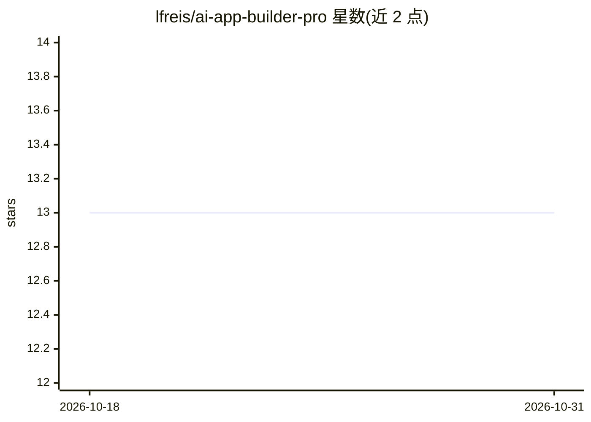

# lfreis/ai-app-builder-pro

⭐ 13 · JavaScript · 推送 2026-10-12 · [GitHub](https://github.com/lfreis/ai-app-builder-pro) · 个人维护

**可视化设计、AI 代为生成应用的零代码应用构建工具**

自述“可视化设计应用，AI 代你构建，零代码”的应用构建工具，面向无编程背景的构建者/快速原型需求。README 仅展示安装与贡献流程：git clone 源码、npm install 安装依赖、npm start 运行，或通过 docker-compose 启动（需本机装有 Docker）。README 中间约 40 行与末尾 49 行内容未展示，产品具体 AI 机制、模型接入方式与功能细节不可验证，目录仅能确认其安装运行路径。

## 筛选速览

| 维度 | 判定 | 备注 |
|---|---|---|
| AI 角色 | `ai-native` | 本体是模型或模型工具 |
| 许可风险 | `none` | — |
| 部署形态 | `self-host` | docker 或自建部署 |
| 模型依赖 | — | README 未给出锁定关系 |
| 硬件要求 | — | 无带数字的原话,不猜 |
| 安装摩擦 | `low` | 无编译、无系统依赖或容器化 |
| 成熟度 | — | 结构信号不足 |

## 能力要点

- 可视化设计 + AI 生成应用，自述零代码
- 提供 npm 源码运行与 docker-compose 两种启动方式

## 适用场景

- 不写代码搭建应用原型/MVP
- 用 Docker 快速部署运行

## 场景标签

 · 领域:应用开发工具/低代码

## 证据(README 行号)

> L4: **Design apps visually. AI builds them for you. Zero coding.**

## 星数曲线

2026-10-18 13 → 2026-10-31 13（+0）

---
*卡片 v1 · prompt 1.4 · 生成 2026-10-31 · 置信度 low · 依据 README sha `a2a33341a7b1` · [字段定义](../../DATASET.md)*
