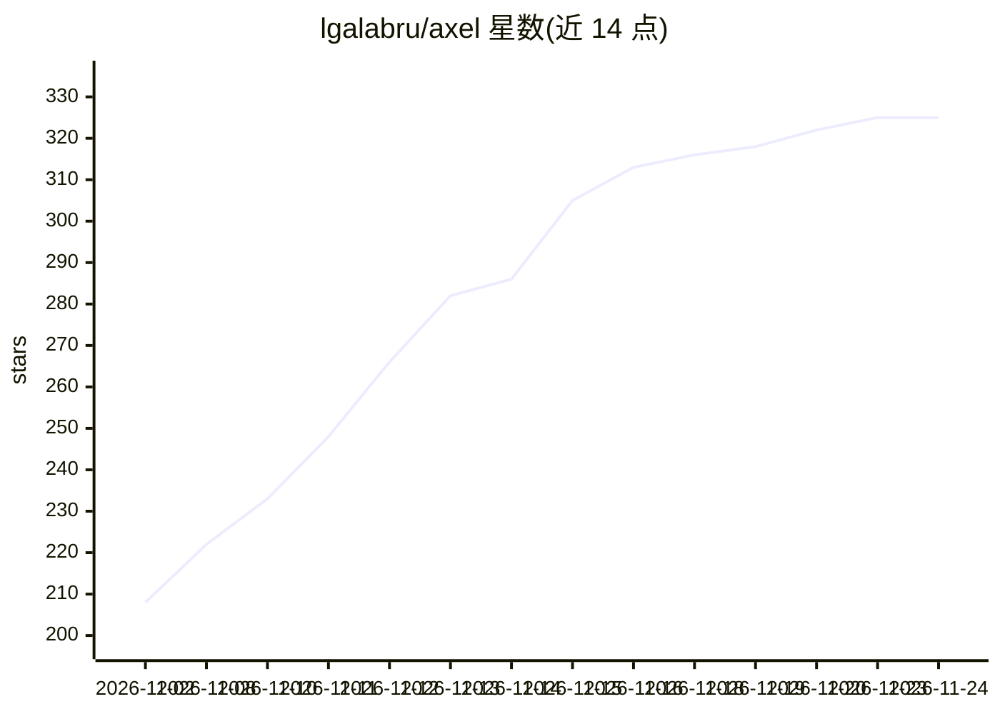

# lgalabru/axel

⭐ 325 · Rust · Apache-2.0 · 推送 2026-11-22 · [GitHub](https://github.com/lgalabru/axel) · [官网](https://axel.md) · 个人维护

**面向 Rex 终端的编码 agent 编排工具：线程与命名 agent 协作**

Axel 是运行在 Rex 终端中的 agent 编排程序：以线程（thread）承载任务意图，跨进程与跨机器存续；以命名 agent 组成团队，各自拥有 Ed25519 密钥、权限、预算与技能集。通过 ACP 协议驱动 Claude Code、Codex 等编码 agent 的 CLI（harness），支持远程主机运行、AXEL.md 统一上下文与技能锁定。安装需 Rex 终端与至少一个 harness，提供 curl 脚本与 Homebrew 两种安装方式。

## 筛选速览

| 维度 | 判定 | 备注 |
|---|---|---|
| AI 角色 | `ai-ecosystem` | LLM/agent 周边工具 |
| 许可风险 | `permissive` | Apache-2.0 |
| 部署形态 | `library` | 以包/库形式分发 |
| 模型依赖 | — | README 未给出锁定关系 |
| 硬件要求 | — | 无带数字的原话,不猜 |
| 安装摩擦 | `low` | 无编译、无系统依赖或容器化 |
| 成熟度 | — | 结构信号不足 |

## 能力要点

- 线程为持久化任务单元，变更以签名事件记录，跨机器合并
- 命名 agent 各有 Ed25519 密钥、权限、预算与独立技能集
- 通过 ACP 协议驱动 Claude Code、Codex、OpenCode、Goose、Cursor 等多种 harness
- 守卫机制拒绝不可逆命令并为每个 agent 设预算上限

## 适用场景

- 在终端中组织多个编码 agent 分工协作与互相评审
- 任务线程跨机器、跨会话接续推进
- 用统一 AXEL.md 为不同 harness 的 agent 提供项目上下文与技能

## 场景标签

`编码 Agent` `多智能体` `Agent 框架` · 领域:Agent 开发

## 证据(README 行号)

> L8:  Agent orchestration, designed for Rex.
> L57: `codex`, `goose`, `cursor/sonnet`. Axel drives Claude Code and Codex over the Agent Client

## 星数曲线

2026-11-02 208 → 2026-11-24 325（+117）

---
*卡片 v1 · prompt 1.4 · 生成 2026-11-17 · 置信度 mid · 依据 README sha `40ae8d9e287b` · [字段定义](../../DATASET.md)*
