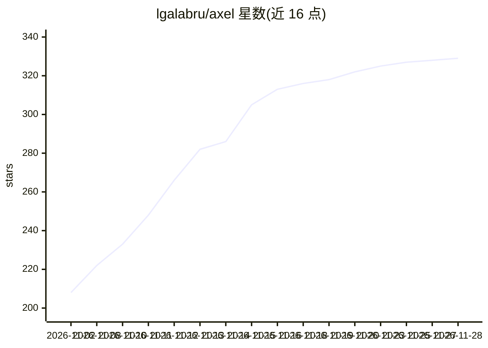

# lgalabru/axel

⭐ 329 · Rust · Apache-2.0 · 推送 2026-11-27 · [GitHub](https://github.com/lgalabru/axel) · [官网](https://axel.md) · 个人维护

**终端里的多 Agent 编排工具：线程化驱动编码 Agent**

面向在终端使用编码 Agent 的开发者：以「线程」为单位组织任务意图与执行记录，线程独立于进程、窗口与机器存在，以签名事件在其他机器间合并。可创建多个具名 Agent，各自拥有 Ed25519 密钥、权限、预算与技能集，在线程中互相移交 diff 协作。通过 ACP 协议以内置适配器驱动 Claude Code 与 Codex，其余 harness 经各自 ACP 模式接入；默认自动执行但拦截不可逆命令并按预算封顶。安装脚本、Homebrew、Nix 三种途径，需搭配 Rex 终端与至少一个 harness 使用。

## 筛选速览

| 维度 | 判定 | 备注 |
|---|---|---|
| AI 角色 | `ai-ecosystem` | LLM/agent 周边工具 |
| 许可风险 | `permissive` | Apache-2.0 |
| 部署形态 | `library` | 以包/库形式分发 |
| 模型依赖 | — | README 未给出锁定关系 |
| 硬件要求 | — | 无带数字的原话,不猜 |
| 安装摩擦 | `low` | 无编译、无系统依赖或容器化 |
| 成熟度 | — | 结构信号不足 |

## 能力要点

- 线程跨进程、跨机器持久存在，以签名事件合并
- 具名 Agent 各有独立密钥、权限、预算与技能加载
- 经 ACP 协议驱动 Claude Code/Codex，状态来自 hooks 与协议而非屏幕抓取
- AXEL.md 单文件统一下发给所有 harness 的上下文与技能

## 适用场景

- 让一个 Agent 写代码、另一个用不同模型审查 diff
- 在笔记本合盖后于其他机器继续未完成的 Agent 任务
- 将 Agent 分配到 tailnet 中的远程主机运行且密钥不出本机

## 场景标签

`多智能体` `编码 Agent` · 领域:Agent 开发

## 证据(README 行号)

> L8:  Agent orchestration, designed for Rex.
> L57: `codex`, `goose`, `cursor/sonnet`. Axel drives Claude Code and Codex over the Agent Client
> L114: You'll need Rex and a harness:

## 星数曲线

2026-11-02 208 → 2026-11-28 329（+121）

---
*卡片 v1 · prompt 1.4 · 生成 2026-11-28 · 置信度 mid · 依据 README sha `cfc5a53f3b4a` · [字段定义](../../DATASET.md)*
