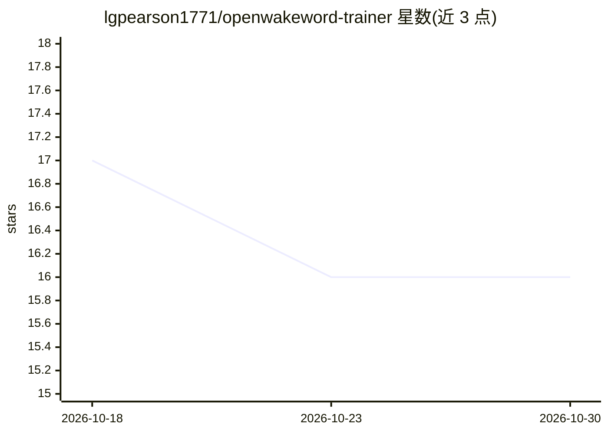

# lgpearson1771/openwakeword-trainer

⭐ 16 · Python · MIT · 推送 2026-02-13 · [GitHub](https://github.com/lgpearson1771/openwakeword-trainer) · 个人维护

**训练自定义唤醒词模型的全流程工具包，产出约 200 KB ONNX 模型**

围绕 openWakeWord 的 13 步训练流水线：用 Piper TTS 合成数万条多音色语音样本，叠加噪声/音乐/房间冲激响应做数据增强，训练面向常开低延迟检测的小型 DNN/RNN 分类器，导出约 200 KB 的 ONNX 模型，可在 CPU 实时运行，兼容任何 openWakeWord 运行时或 ONNX Runtime 直接加载。内置 torchaudio 2.10+、speechbrain、Piper 的兼容补丁与逐步校验/断点续跑。要求 WSL2/Linux 环境与 NVIDIA GPU（CUDA），训练约 1-2 小时，磁盘占用约 15 GB。

## 筛选速览

| 维度 | 判定 | 备注 |
|---|---|---|
| AI 角色 | `ai-native` | 本体是模型或模型工具 |
| 许可风险 | `permissive` | MIT |
| 部署形态 | `None` |  |
| 模型依赖 | — | README 未给出锁定关系 |
| 硬件要求 | — | 无带数字的原话,不猜 |
| 安装摩擦 | `medium` | 含编译或系统依赖之一 |
| 成熟度 | — | 结构信号不足 |

## 能力要点

- Piper TTS 合成 + 噪声/混响增强自动生成训练数据
- 13 步流水线，每步校验，失败可从断点恢复
- 导出约 200 KB ONNX 模型，CPU 实时推理
- 内置 torchaudio 2.10+/speechbrain/Piper 兼容补丁

## 适用场景

- 为语音助手项目训练自定义"Hey XX"唤醒词
- 在边缘/低算力设备上部署轻量关键词检测模型
- 通过负样本短语与阈值调优控制误唤醒率

## 场景标签

`模型训练` · 领域:训练与推理

## 证据(README 行号)

> L3: Train custom wake word models with openWakeWord. A granular 13-step pipeline with compatibility patches for torchaud
> L11: 3. **Trains** a small DNN classifier optimized for always-on, low-latency detection
> L12: 4. **Exports** a tiny ONNX model you can deploy anywhere

## 星数曲线

2026-10-18 17 → 2026-10-30 16（-1）

---
*卡片 v1 · prompt 1.4 · 生成 2026-10-30 · 置信度 high · 依据 README sha `376ee0d19b9e` · [字段定义](../../DATASET.md)*
