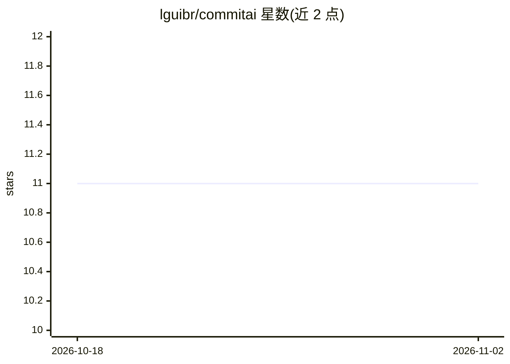

# lguibr/commitai

⭐ 11 · Python · NOASSERTION · 推送 2026-07-15 · [GitHub](https://github.com/lguibr/commitai) · 个人维护

**分析 git diff 生成 Conventional Commits 提交信息的 CLI 工具**

Python 编写的命令行工具：运行 commitai 后读取 git diff --staged，可选接受用户高层说明，调用 OpenAI/Anthropic/Google 或 Ollama 本地模型生成符合 Conventional Commits 规范的提交信息，随后在默认 Git 编辑器中供用户审阅修改再提交。默认模型为 gemini-flash-latest，需设置对应 API key；支持生成前 AI 预审、仓库级/全局模板注入额外指令，并自动运行既有 pre-commit 钩子。要求 Python 3.10+，macOS/Linux 环境，经 pip 安装。

## 筛选速览

| 维度 | 判定 | 备注 |
|---|---|---|
| AI 角色 | `ai-native` | 本体是模型或模型工具 |
| 许可风险 | `none` | NOASSERTION |
| 部署形态 | `library` | 以包/库形式分发 |
| 模型依赖 | local-ok | 支持本地模型 |
| 硬件要求 | — | 无带数字的原话,不猜 |
| 安装摩擦 | `low` | 无编译、无系统依赖或容器化 |
| 成熟度 | — | 结构信号不足 |

## 能力要点

- 从 staged diff 生成 Conventional Commits 格式提交信息
- 支持 OpenAI/Anthropic/Google 及 Ollama 本地模型
- 可选 AI 预审（--review）与模板自定义指令（全局/仓库级）
- 生成前自动运行原生 pre-commit 钩子

## 适用场景

- 不想手写 commit message 时自动生成规范化提交信息
- 团队统一 Conventional Commits 格式并接入变更日志生成
- 通过模板强制提交信息附带 JIRA/GitHub issue 编号

## 场景标签

 · 领域:开发者工具/Git 自动化

## 证据(README 行号)

> L24: **CommitAi** streamlines your Git workflow by leveraging powerful AI models (OpenAI's GPT, Anthropic's Claude, Goog
> L32: * 🧠 **Intelligent Commit Generation**: Analyzes staged code differences (`git diff --staged`) using state-of-the-ar
> L37: * 🤖 **Multiple AI Provider Support**: Choose your preferred AI model from OpenAI, Anthropic, Google or local AI mod

## 星数曲线

2026-10-18 11 → 2026-11-02 11（+0）

---
*卡片 v1 · prompt 1.4 · 生成 2026-11-02 · 置信度 high · 依据 README sha `8aa1ef07a16d` · [字段定义](../../DATASET.md)*
