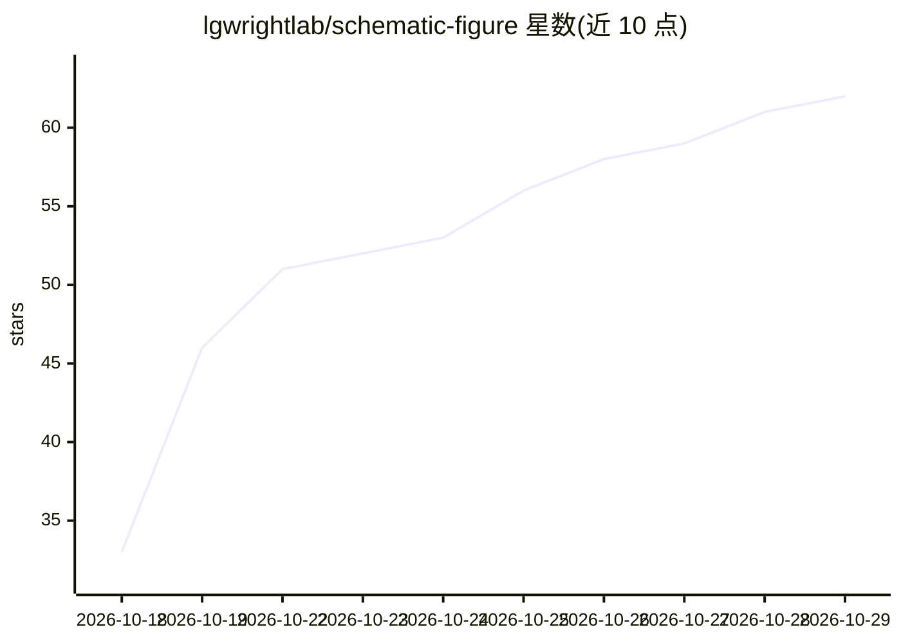

# lgwrightlab/schematic-figure

⭐ 62 · JavaScript · MIT · 推送 2026-10-14 · [GitHub](https://github.com/lgwrightlab/schematic-figure) · [官网](https://lgwrightlab.github.io/schematic-figure/) · 组织维护

**AI agent 技能：为科研论文绘制可编辑的矢量示意图**

面向 Claude Code / Codex 等 agent 的技能包，用于生成科研论文的示意图初稿，输出 SVG、PDF 与 PNG 的矢量图形及其绘制代码，用户可编辑任意部分。支持指定风格参照、2D/3D/Blender 渲染、期刊栏宽尺寸与三档校验深度；README 声明该技能不替代人工设计，仅提供快速初稿与设计思路。运行需 Node.js 22+ 与 Chromium，Blender 与 RDKit 为可选依赖，另附用同引擎绘专利图的 patent-drawing 技能。

## 筛选速览

| 维度 | 判定 | 备注 |
|---|---|---|
| AI 角色 | `ai-native` | 本体是模型或模型工具 |
| 许可风险 | `permissive` | MIT |
| 部署形态 | `None` |  |
| 模型依赖 | — | README 未给出锁定关系 |
| 硬件要求 | — | 无带数字的原话,不猜 |
| 安装摩擦 | `low` | 无编译、无系统依赖或容器化 |
| 成熟度 | — | 结构信号不足 |

## 能力要点

- 生成 SVG/PDF 矢量图及绘制代码，各部分可编辑
- 三档校验深度（draft/standard/full），full 档绘制两版择优并复查
- 支持风格参照、2D/自带矢量 3D/Blender 渲染与期刊栏宽尺寸
- 附带复用同一引擎的 patent-drawing 专利图技能

## 适用场景

- 为我的论文快速生成示意图初稿并拿到可编辑的矢量代码
- 并行跑多个 agent 拿到多个设计方案再组合
- 按我以往论文的配色与线宽生成同风格新图

## 场景标签

`科研工具` `图像生成` · 领域:内容生成

## 证据(README 行号)

> L3: A skill for AI agents that draws publication-quality schematic figures for scientific papers. It gives you vector gr
> L31: You can also ask your agent to install it. In Codex, name the path of `SKILL.md` in your prompt. The skill needs No

## 星数曲线

2026-10-18 33 → 2026-10-29 62（+29）

---
*卡片 v1 · prompt 1.4 · 生成 2026-10-24 · 置信度 high · 依据 README sha `6435ab6bd8ed` · [字段定义](../../DATASET.md)*
