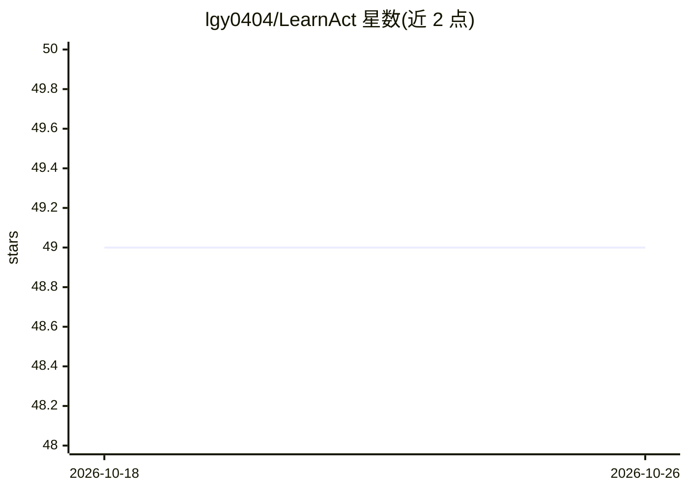

# lgy0404/LearnAct

⭐ 49 · Python · 推送 2026-08-29 · [GitHub](https://github.com/lgy0404/LearnAct) · [官网](https://lgy0404.github.io/LearnAct/) · 组织维护

**少样本移动 GUI agent 框架与演示学习基准 LearnGUI**

ACL 2026 Findings 论文的官方仓库：提供 LearnGUI 基准（2,252 个离线任务、101 个在线任务、覆盖 73 个移动应用、含人类演示轨迹与 k-shot 组合），以及 LearnAct 多 agent 框架的推理与评测代码。框架含三个 agent：DemoParser 从演示轨迹抽取知识、KnowSeeker 检索相关知识、ActExecutor 结合指令与 GUI 环境执行任务。通过 conda 环境安装依赖、从 HuggingFace 下载数据、调用 LLM API（如 gpt-4o-mini）运行离线推理与评测；在线评测与实际部署代码尚未发布。

## 筛选速览

| 维度 | 判定 | 备注 |
|---|---|---|
| AI 角色 | `ai-native` | 本体是模型或模型工具 |
| 许可风险 | `none` | — |
| 部署形态 | `library` | 以包/库形式分发 |
| 模型依赖 | — | README 未给出锁定关系 |
| 硬件要求 | — | 无带数字的原话,不猜 |
| 安装摩擦 | `low` | 无编译、无系统依赖或容器化 |
| 成熟度 | `idea` | |

## 能力要点

- LearnGUI：2,252 离线任务 + 101 在线任务，覆盖 73 个应用
- DemoParser / KnowSeeker / ActExecutor 三 agent 架构
- k-shot（k=1,2,3）少样本演示增强，离线评测报告逐步与全任务准确率
- 提供完整离线推理与评测脚本（gen_messages.py / offline_infer.py）

## 适用场景

- 研究者在统一基准上评测演示学习对移动 GUI agent 的增益
- 复现论文中少样本增强的离线/在线实验结果
- 基于演示轨迹数据训练或改进 GUI agent 方法

## 场景标签

`Agent 框架` `多智能体` `GUI 自动化` `模型评测` · 领域:Agent 开发

## 证据(README 行号)

> L26: To realize this paradigm, we introduce LearnGUI, the first comprehensive dataset specifically designed for studying
> L77: 1. **DemoParser**: Extracts usable knowledge from demonstration trajectories
> L141: python offline_infer.py \

## 星数曲线

2026-10-18 49 → 2026-10-26 49（+0）

---
*卡片 v1 · prompt 1.4 · 生成 2026-10-24 · 置信度 high · 依据 README sha `123c8e8d3510` · [字段定义](../../DATASET.md)*
