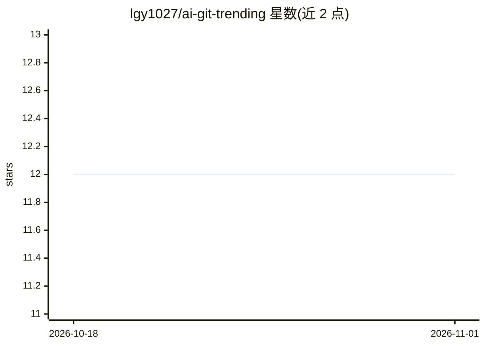

# lgy1027/ai-git-trending

⭐ 12 · Vue · 推送 2026-10-28 · [GitHub](https://github.com/lgy1027/ai-git-trending) · [官网](https://git-report.iepose.cn/) · 个人维护 · 中文 README

**自动抓取 GitHub Trending 并用 LLM 生成分析报告与 Web 看板**

每日定时（默认 09:00，可配）抓取 GitHub Trending 项目，调用兼容 OpenAI 协议的 LLM 服务生成「一句话点评 / 技术亮点 / 潜在影响」三段式分析，结果存入 SQLite 并产出 Markdown / HTML 报告。附带 Vue 3 + TypeScript + Tailwind 前端看板，提供排行榜、趋势图谱、技术领域分类、收藏（localStorage + 匿名 client_id）等功能。后端 Flask，支持 Docker Compose 部署与 full / web / reporter 三种运行模式。需自备 LLM API Key，前置要求 Python 3.9+ 与 Node.js 18+。

## 筛选速览

| 维度 | 判定 | 备注 |
|---|---|---|
| AI 角色 | `ai-native` | 本体是模型或模型工具 |
| 许可风险 | `permissive` | — |
| 部署形态 | `self-host` | docker 或自建部署 |
| 模型依赖 | — | README 未给出锁定关系 |
| 硬件要求 | — | 无带数字的原话,不猜 |
| 安装摩擦 | `low` | 无编译、无系统依赖或容器化 |
| 成熟度 | — | 结构信号不足 |

## 能力要点

- 每日定时抓取 GitHub Trending（daily/weekly/monthly 可选）并用 LLM 生成三段式分析
- 产出 Markdown / HTML 双格式报告并持久化到 SQLite
- Vue 3 交互式看板：排行榜、趋势图谱、技术领域分类、匿名收藏
- 支持任意兼容 OpenAI 协议的 LLM 服务（OpenAI / DeepSeek / 通义千问 / 自部署）

## 适用场景

- 每天自动获取 GitHub 热门项目的 LLM 深度分析报告
- 通过 Web 看板浏览历史趋势并收藏感兴趣的项目
- 把生成的报告内容直接复制到公众号或博客

## 场景标签

`网页抓取` `AI 写作` · 领域:效率与自动化

## 证据(README 行号)

> L14: 每天 09:00（可配）自动抓取 GitHub Trending 热门项目，用大模型生成「一句话点评 / 技术亮点 / 潜在影响」三段式分析，沉淀到 SQLite 并产出 Markdown / HTML 报告，同时提供交互式 We
> L26: - 自动调用 LLM 生成「一句话点评、技术亮点、潜在影响」三段式分析

## 星数曲线

2026-10-18 12 → 2026-11-01 12（+0）

---
*卡片 v1 · prompt 1.4 · 生成 2026-11-01 · 置信度 high · 依据 README sha `3d26d5900346` · [字段定义](../../DATASET.md)*
