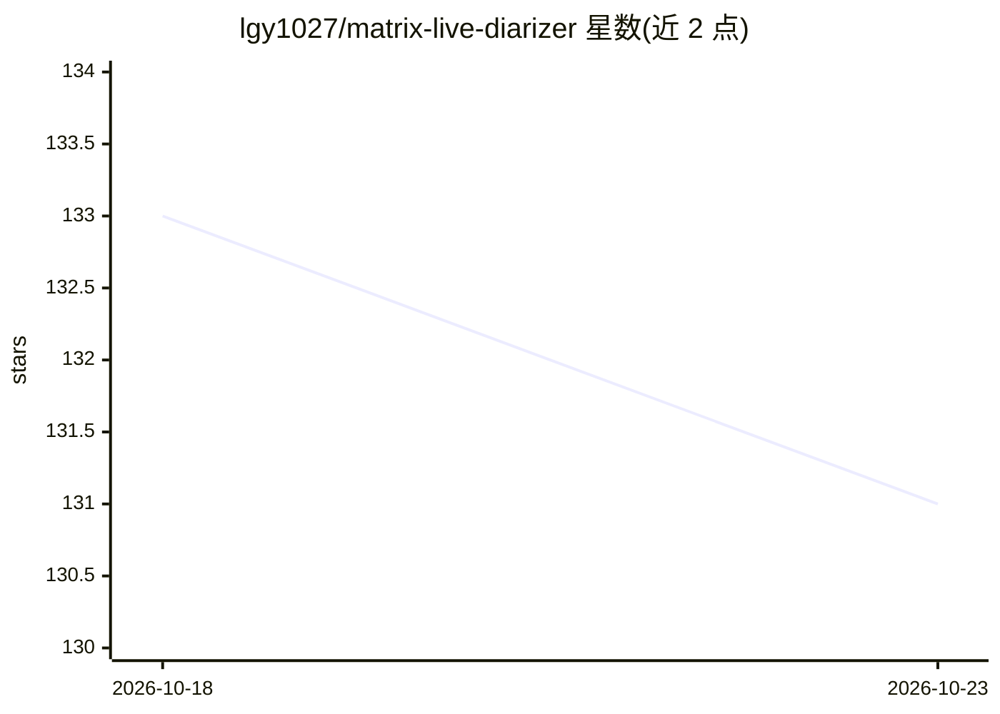

# lgy1027/matrix-live-diarizer

⭐ 131 · Python · MIT · 推送 2026-08-03 · [GitHub](https://github.com/lgy1027/matrix-live-diarizer) · 个人维护 · 中文 README

**本机优先的会议转写工具：上传分离 + 实时字幕 + 声纹匹配**

面向单台受信任机器的本地会议录音转写工具：上传录音经解码、ASR、可选 pyannote 多人分离、声纹匹配登记人物后入库，可校正文稿、生成纪要并导出 Markdown/SRT/VTT/JSON；实时路径经浏览器录音、VAD 切段、ASR 与声纹识别实现近实时字幕。音频与声纹不外传，LLM 纪要可选本机 Ollama 或经显式允许的公网 LLM（仅发文本）。ASR 与声纹引擎运行时可切换，未配置 pyannote 时仍可转写但保持匿名。需 Python 3.10–3.12、Node.js 20+ 与 FFmpeg，首次启动下载约 1.8GB 模型。

## 筛选速览

| 维度 | 判定 | 备注 |
|---|---|---|
| AI 角色 | `ai-native` | 本体是模型或模型工具 |
| 许可风险 | `permissive` | MIT |
| 部署形态 | `self-host` | docker 或自建部署 |
| 模型依赖 | local-ok | 支持本地模型 |
| 硬件要求 | — | 无带数字的原话,不猜 |
| 安装摩擦 | `low` | 无编译、无系统依赖或容器化 |
| 成熟度 | `idea` | |

## 能力要点

- 上传会议模式支持 pyannote 多人说话人分离与声纹匹配登记人物
- 实时字幕：浏览器录音 + VAD 切段 + ASR + 声纹识别边说边出
- 音频与声纹不出本机，LLM 关闭且模型下载后可离线运行
- ASR（Qwen3-ASR/SenseVoice/Paraformer）与声纹引擎运行时可切换

## 适用场景

- 会后上传会议录音做多说话人转写、校正与纪要导出
- 会议进行中获得本地近实时字幕并识别已登记说话人
- 隐私敏感场景下不让音频离开本机完成转写

## 场景标签

`语音识别` · 领域:感知与多模态

## 证据(README 行号)

> L16: 把"一段会议录音"变成"带说话人归属、可校正、可导出"的结构化纪要，**音频和转写永远不出本机**。飞书/讯飞/在线 ASR 都要把音频传上云——本项目不上传音频。LLM 纪要可选本机 Ollama，公网 LLM 只在你显式允许时
> L20: - 📤 **上传录音（会后高质量处理）**：解码 → ASR → 可选 pyannote 多人分离 → 声纹匹配已登记人物 → 入库 → 校正/纪要/导出。
> L21: - ⚡ **实时字幕（会议进行中）**：浏览器录音 → VAD 切段 → ASR → 声纹识别已登记人物 → 边说边出，落段入库。

## 星数曲线

2026-10-18 133 → 2026-10-23 131（-2）

---
*卡片 v1 · prompt 1.4 · 生成 2026-10-23 · 置信度 high · 依据 README sha `6d3328f5c46c` · [字段定义](../../DATASET.md)*
