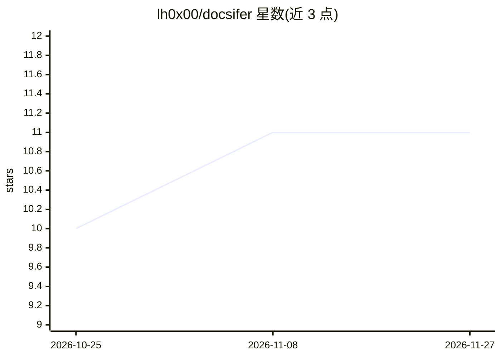

# lh0x00/docsifer

⭐ 11 · Python · MIT · 推送 2026-05-27 · [GitHub](https://github.com/lh0x00/docsifer) · [官网](https://lamhieu-docsifer.hf.space) · 个人维护

**将多格式文档转换为 LLM 就绪 Markdown 的转换服务**

基于 Python/FastAPI 的文档转 Markdown 服务，支持 PDF、Office、音频、图像、HTML、CSV、JSON、ZIP 等格式，底层由 MarkItDown 驱动；可选传入 OpenAI 兼容 API key 进行 OCR、转录与结构化版式提取。提供 /v1/convert REST API、Web UI 与健康检查端点，内置并发限制、每 IP 公平队列、SSRF 防护、请求体大小限制等运行防护，文件在内存中处理并即时丢弃。通过 make install 本地安装或 Docker 运行，配置由 DOCSIFER_ 前缀环境变量驱动。

## 筛选速览

| 维度 | 判定 | 备注 |
|---|---|---|
| AI 角色 | `ai-enhanced` | 去掉 AI 部分产品仍成立 |
| 许可风险 | `permissive` | MIT |
| 部署形态 | `None` |  |
| 模型依赖 | — | README 未给出锁定关系 |
| 硬件要求 | — | 无带数字的原话,不猜 |
| 安装摩擦 | `medium` | 含编译或系统依赖之一 |
| 成熟度 | — | 结构信号不足 |

## 能力要点

- 支持 PDF/Office/音频/图像/HTML 等多格式转 Markdown
- 可选接入 OpenAI 兼容 API 做 OCR 与转录
- 提供 /v1/convert REST API、健康检查与用量统计端点
- 文件内存处理即弃，含 SSRF 防护与上传大小限制

## 适用场景

- 为 RAG 索引流水线批量准备 Markdown 语料
- 对文档做文本分析前的格式统一
- 通过 API 将网页 URL 转为 Markdown

## 场景标签

`文档解析` · 领域:知识与检索

## 证据(README 行号)

> L13: **Convert documents into clean, LLM-ready Markdown.**
> L25: - **Optional LLM** — bring your own OpenAI-compatible key for OCR, transcription and structured layout extraction.

## 星数曲线

2026-10-25 10 → 2026-11-27 11（+1）

---
*卡片 v1 · prompt 1.4 · 生成 2026-11-18 · 置信度 high · 依据 README sha `4cc9fbbc55f3` · [字段定义](../../DATASET.md)*
