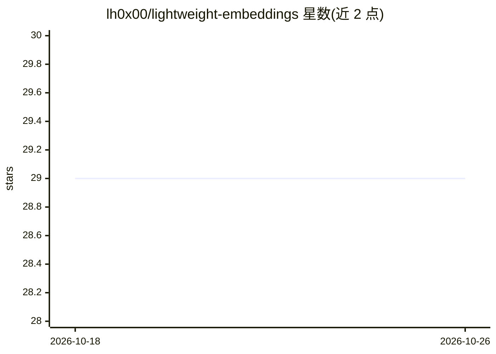

# lh0x00/lightweight-embeddings

⭐ 29 · Python · MIT · 推送 2026-05-27 · [GitHub](https://github.com/lh0x00/lightweight-embeddings) · [官网](https://lamhieu-lightweight-embeddings.hf.space) · 个人维护

**多语文本+图像 embedding 与重排序的 OpenAI 兼容 API 服务**

单 Docker 镜像部署的 embedding/reranking API 服务：内置 10 个模型（9 个多语文本模型含 e5/bge-m3/embeddinggemma 等，1 个图像模型 siglip），通过 model 字段切换、按需加载。提供 OpenAI 兼容端点 /v1/embeddings、/v1/rank、/v1/models，支持 base64 编码与 Matryoshka 维度截断。含匿名/free/pro 三级配额、速率限制、Prometheus 指标与 Redis 分析持久化（可选）。CPU/CUDA 可配置，MIT 许可。

## 筛选速览

| 维度 | 判定 | 备注 |
|---|---|---|
| AI 角色 | `ai-native` | 本体是模型或模型工具 |
| 许可风险 | `permissive` | MIT |
| 部署形态 | `self-host` | docker 或自建部署 |
| 模型依赖 | — | README 未给出锁定关系 |
| 硬件要求 | — | 无带数字的原话,不猜 |
| 安装摩擦 | `low` | 无编译、无系统依赖或容器化 |
| 成熟度 | — | 结构信号不足 |

## 能力要点

- 单镜像内置 10 个模型，按需加载、model 字段切换
- OpenAI 兼容端点（/v1/embeddings、/v1/rank），支持 base64 与 Matryoshka dimensions
- 三级配额、多级速率限制、自适应 shedding 与内存保护
- Prometheus /metrics、结构化 JSON 日志、健康检查端点

## 适用场景

- 自托管多语 embedding 服务供 RAG 流水线调用
- 为文档与图像生成统一向量并做余弦重排序
- 通过 OpenAI 兼容接口替换现有 embedding 提供方

## 场景标签

`推理引擎` `语义搜索` · 领域:知识与检索

## 证据(README 行号)

> L11: A multilingual **text + image** embedding & reranking API.
> L23: - **OpenAI-compatible** — `/v1/embeddings`, `/v1/rank`, `/v1/models`; supports `encoding_format=base64` and Matryos

## 星数曲线

2026-10-18 29 → 2026-10-26 29（+0）

---
*卡片 v1 · prompt 1.4 · 生成 2026-10-26 · 置信度 high · 依据 README sha `9a777829df63` · [字段定义](../../DATASET.md)*
