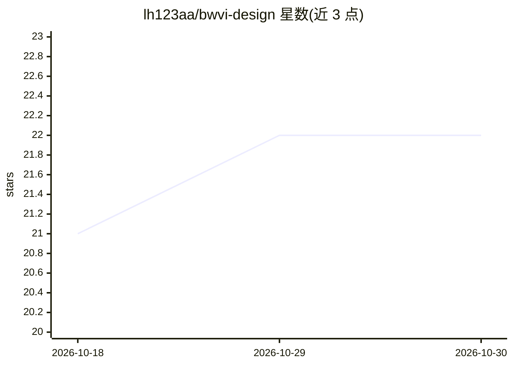

# lh123aa/bwvi-design

⭐ 22 · TypeScript · AGPL-3.0 · 推送 2026-10-17 · [GitHub](https://github.com/lh123aa/bwvi-design) · 个人维护 · 中文 README

**给 AI Agent 的设计决策协议：CLI + MCP 设计决策层**

面向 AI Agent 与开发者的设计决策层工具，以 CLI（npx/npm 安装）与 MCP Server 形式提供。核心是渐进约束的决策链（方向→色板→字体→布局→细节签名），决策持久化为 JSON、可回滚；内置 115 个品牌、56 种风格、50+ 行业蓝图，generate --direct 约 200ms 直出 HTML，支持导出 PDF/PNG/PPTX/DOCX、动画注入与视频录制（录制需 ffmpeg）。另含 10+5 维评审、从 URL 学习设计 Token 的持续学习系统（自我评估综合 5.5/10）。图片生成需各提供商 API Key。

## 筛选速览

| 维度 | 判定 | 备注 |
|---|---|---|
| AI 角色 | `ai-ecosystem` | LLM/agent 周边工具 |
| 许可风险 | `viral` | AGPL-3.0 |
| 部署形态 | `library` | 以包/库形式分发 |
| 模型依赖 | — | README 未给出锁定关系 |
| 硬件要求 | — | 无带数字的原话,不猜 |
| 安装摩擦 | `medium` | 含编译或系统依赖之一 |
| 成熟度 | — | 结构信号不足 |

## 能力要点

- 渐进约束决策链（direction→palette→typography→layout→detail），决策持久化 JSON 可回滚
- 内置 115 品牌 + 56 风格 + 50+ 行业蓝图，--direct 约 200ms 生成 HTML
- CLI + MCP Server（15 设计工具 + 4 学习工具）接入 Agent
- 导出 PDF/PNG/PPTX/DOCX 与动画录制（录制需 ffmpeg）

## 适用场景

- 让 AI Agent 在生成页面前先产出可追溯的设计决策
- 按品牌色板与 56 种风格快速生成 landing page/幻灯片/海报
- 通过 MCP 让 Claude 类 Agent 调用设计与评审工具
- 对生成 HTML 做客观与主观维度的设计评审

## 场景标签

`代码生成` · 领域:编码与开发

## 证据(README 行号)

> L3:  Agent 原生设计决策协议 — 一行命令，给 AI Agent 装上一个有理由的设计大脑
> L16: **BWVI 不是设计工具。** 它是 AI Agent 与设计执行之间的**决策层**。它不画像素——它确保每个像素都有理由。
> L452: ## 🤖 MCP Server

## 星数曲线

2026-10-18 21 → 2026-10-30 22（+1）

---
*卡片 v1 · prompt 1.4 · 生成 2026-10-28 · 置信度 high · 依据 README sha `65019f73cadc` · [字段定义](../../DATASET.md)*
