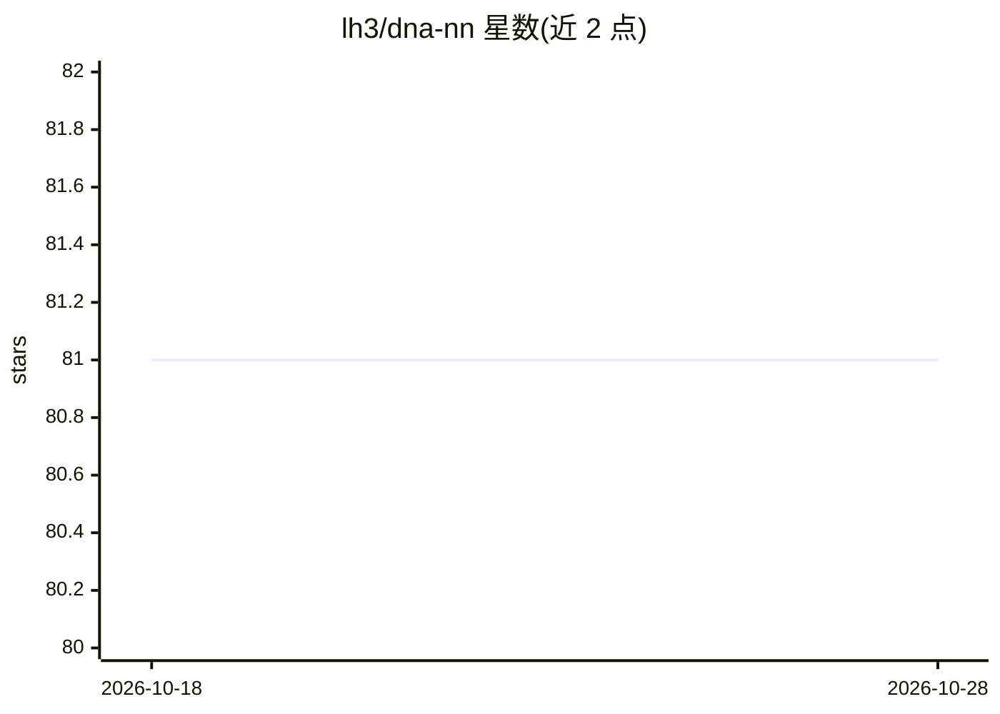

# lh3/dna-nn

⭐ 81 · C · MIT · 推送 2026-07-22 · [GitHub](https://github.com/lh3/dna-nn) · 个人维护

**用神经网络识别 DNA 卫星序列的生物信息工具**

C 语言实现的深度学习概念验证工具 dna-nn，基于内置源码的 KANN 框架，用神经网络学习 DNA 序列特征：识别 (ATTCC)n 与 alpha 卫星重复（占人类基因组 5% 以上），以 RepeatMasker 注释为真值训练，可在 16 CPU 上 1.5 小时内注释人类 PacBio 组装。输出 BED 文件，支持训练与精度评估。局限：对 Beta 卫星敏感度低，无法学习 L1 重复。面向生物信息分析人员，唯一外部依赖 zlib，需源码编译。

## 筛选速览

| 维度 | 判定 | 备注 |
|---|---|---|
| AI 角色 | `ai-native` | 本体是模型或模型工具 |
| 许可风险 | `permissive` | MIT |
| 部署形态 | `None` |  |
| 模型依赖 | — | README 未给出锁定关系 |
| 硬件要求 | — | 无带数字的原话,不猜 |
| 安装摩擦 | `low` | 无编译、无系统依赖或容器化 |
| 成熟度 | `idea` | |

## 能力要点

- 识别 (ATTCC)n 与 alpha 卫星重复，注释人类 PacBio 组装
- 内嵌 KANN 深度学习框架源码，唯一外部依赖为 zlib
- 提供预训练模型、训练与评估流程

## 适用场景

- 在长 contig 上快速定位两类着丝粒卫星重复
- 替代 RepeatMasker 高耗时地注释特定卫星序列
- 用自己的 FASTQ 标注数据训练新模型

## 场景标签

 · 领域:生物信息学/基因组学

## 证据(README 行号)

> L3: Dna-nn implements a proof-of-concept deep-learning model to learn relatively
> L4: simple features on DNA sequences. So far it has been trained to identify the

## 星数曲线

2026-10-18 81 → 2026-10-28 81（+0）

---
*卡片 v1 · prompt 1.4 · 生成 2026-10-24 · 置信度 high · 依据 README sha `3000692a8f48` · [字段定义](../../DATASET.md)*
