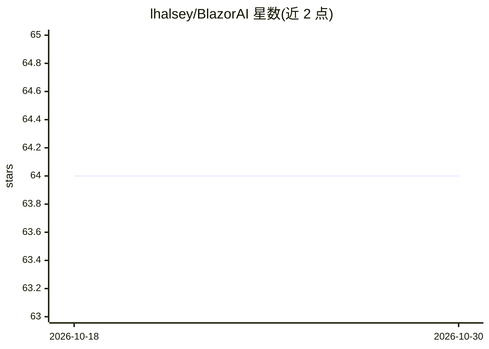

# lhalsey/BlazorAI

⭐ 64 · C# · 推送 2026-08-23 · [GitHub](https://github.com/lhalsey/BlazorAI) · [官网](https://www.blazor.ai/) · 个人维护

**Blazor 网页应用：用遗传算法探索求解多类问题**

基于 Blazor 与 GeneticSharp 遗传算法库开发的 Web 应用，用于探索遗传算法求解问题的过程。已实现旅行商、五房屋/斑马谜题、八皇后、密码破解、Genius Square 五个问题，每个问题提供求解器代码及部分问题描述。界面组件使用 Blazorise，项目灵感来自 Tensorflow Playground。给对遗传算法与 .NET Web 开发感兴趣的开发者和学习者使用。

## 筛选速览

| 维度 | 判定 | 备注 |
|---|---|---|
| AI 角色 | `ai-native` | 本体是模型或模型工具 |
| 许可风险 | `none` | — |
| 部署形态 | `None` |  |
| 模型依赖 | — | README 未给出锁定关系 |
| 硬件要求 | — | 无带数字的原话,不猜 |
| 安装摩擦 | `low` | 无编译、无系统依赖或容器化 |
| 成熟度 | — | 结构信号不足 |

## 能力要点

- 基于 GeneticSharp 遗传算法库演化求解方案
- 已实现 5 个问题（旅行商、斑马谜题、八皇后、密码破解、Genius Square）
- Blazor + Blazorise 构建的 Web 交互界面

## 适用场景

- 在浏览器中观察遗传算法求解经典问题的过程
- 学习遗传算法的求解器实现代码
- 作为 Blazor 与 AI 算法结合的参考项目

## 场景标签

`教程课程` · 领域:学习与行业

## 证据(README 行号)

> L3: BlazorAI is a web app developed in Blazor to explore the use of Genetic Algorithms for solving problems.
> L5: The Genetic Algorithm library used for evolving solutions is GeneticSharp by Diego Giacomelli.

## 星数曲线

2026-10-18 64 → 2026-10-30 64（+0）

---
*卡片 v1 · prompt 1.4 · 生成 2026-10-24 · 置信度 mid · 依据 README sha `ef432c4e55e0` · [字段定义](../../DATASET.md)*
