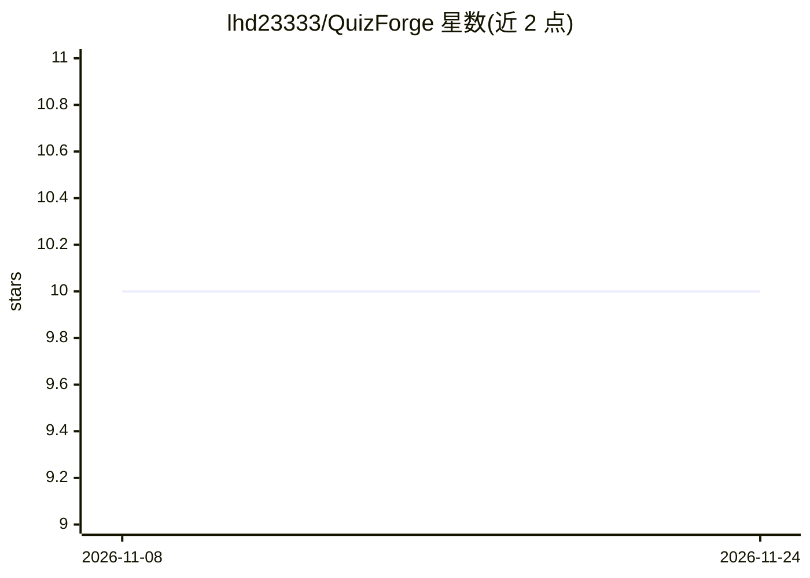

# lhd23333/QuizForge

⭐ 10 · Python · GPL-3.0 · 推送 2026-10-05 · [GitHub](https://github.com/lhd23333/QuizForge) · 个人维护 · 中文 README

**给教师和学生的本地数学/物理题库管理与组卷工具**

本地优先的 Windows 数学/物理题库工作台：将 PDF、Word、图片试卷经 OCR 识别拆题为 Markdown 题目文件，支持文件夹分类、标签难度筛选、结构化搜索与查重，勾选题目后可按版式组合导出 PDF、Word 或 LaTeX 源码包（可上传 Overleaf）。题目以普通 Markdown 文件存储，可用 Obsidian 打开；OCR 与大模型规范化为可选能力，需用户自行配置 MinerU、Doc2X 或 API 凭据，未配置时可手动建题。另提供 Agent 对话工作区、MCP server 接入及安全 TeX 模板校验。

## 筛选速览

| 维度 | 判定 | 备注 |
|---|---|---|
| AI 角色 | `ai-enhanced` | 去掉 AI 部分产品仍成立 |
| 许可风险 | `viral` | GPL-3.0 |
| 部署形态 | `desktop` | 安装包/桌面程序 |
| 模型依赖 | — | README 未给出锁定关系 |
| 硬件要求 | — | 无带数字的原话,不猜 |
| 安装摩擦 | `low` | 无编译、无系统依赖或容器化 |
| 成熟度 | `idea` | |

## 能力要点

- 试卷批量 OCR 导入与拆题人工审核，识别历史可复用
- 导出抽屉组合版式，生成 PDF/Word/LaTeX（可上传 Overleaf）
- Agent 工作区对话完成检索、整理、导入导出，支持 MCP server 接入
- 题目以普通 Markdown 文件存储，兼容 Obsidian

## 适用场景

- 把历年试卷 PDF 整理成可检索的本地题库
- 勾选题目按版式组合导出试卷、刷题册或讲义
- 通过 Agent 对话完成题库的整理与组卷操作

## 场景标签

`OCR` `文档解析` · 领域:知识与检索

## 证据(README 行号)

> L12: QuizForge 是面向教师、学生和内容整理者的开源数学／物理题库工具。你可以把 PDF、Word 或图片试卷识别成题目，在文件夹中分类、搜索和修改，再勾选题目、在右侧导出抽屉里选好版式，导出 PDF、Word 或 LaTeX 
> L14: 题目与图片保存在你的电脑上，不需要账号、邀请码或设备激活。自动识别属于可选能力：需要时填写自己的 MinerU、Doc2X 或大模型 API，不配置也可以手动建题、整理题库和导出。
> L172: - **AI 识别**：PDF/Word/图片 → MinerU 或 Doc2X OCR → DeepSeek（或任意 OpenAI 兼容模型）规范化，也可跳过 LLM 直接机械拆题

## 星数曲线

2026-11-08 10 → 2026-11-24 10（+0）

---
*卡片 v1 · prompt 1.4 · 生成 2026-11-19 · 置信度 mid · 依据 README sha `f6c1fa6ed19c` · [字段定义](../../DATASET.md)*
