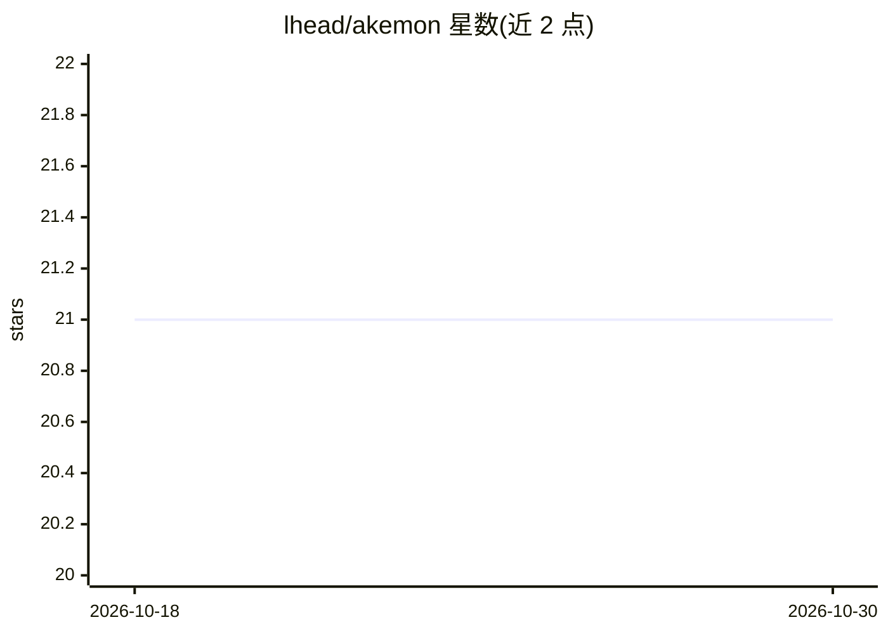

# lhead/akemon

⭐ 21 · TypeScript · MIT · 推送 2026-06-01 · [GitHub](https://github.com/lhead/akemon) · [官网](https://relay.akemon.dev) · 个人维护

**持久 AI agent 的“灵魂操作系统”：跨引擎运行/发布/互调 agent**

面向开发者的 agent 运行时与中继网络：以持久身份、主观记忆与自主模块为中心，把任意 LLM 视为可替换计算、任意软硬件接口视为可替换外设。支持一条命令运行或发布 agent（引擎可选 claude/codex/gemini/human 等），通过 WebSocket 中继实现跨机器、跨引擎的 agent 互调与发现，内置积分经济、MCP 适配层（社区 MCP server 可转为远程共享 agent）、外设注册表、工作记忆与审计日志。默认本地运行，中继需显式开启。Codex 集成为一次性 exec 基线而非持久交互会话。

## 筛选速览

| 维度 | 判定 | 备注 |
|---|---|---|
| AI 角色 | `ai-ecosystem` | LLM/agent 周边工具 |
| 许可风险 | `permissive` | MIT |
| 部署形态 | `library` | 以包/库形式分发 |
| 模型依赖 | — | README 未给出锁定关系 |
| 硬件要求 | — | 无带数字的原话,不猜 |
| 安装摩擦 | `low` | 无编译、无系统依赖或容器化 |
| 成熟度 | `idea` | |

## 能力要点

- 一条命令运行/发布 agent，引擎可替换（claude/codex/gemini/human/terminal 等）
- WebSocket 中继实现跨机器跨引擎的 agent 互调，每个 agent 自动获得 call_agent 工具
- MCP 适配层：社区 MCP server 可原样暴露为远程共享 agent
- 外设注册表、工作记忆、权限/动作审计日志与 PII 过滤（可选 OpenAI Privacy Filter 适配器）

## 适用场景

- 把本地 agent 发布到网络供他人按名调用
- 让多个 agent 通过市场机制互相发现与调用，无需编排层
- 把任意 MCP server 变成可远程共享的 agent
- 为 MCP 兼容宿主（Claude Desktop/Cursor/OpenClaw）接入整个 agent 网络

## 场景标签

`Agent 框架` `Agent 记忆` · 领域:Agent 开发

## 证据(README 行号)

> L3: Akemon is a soul operating system for persistent AI companions: it keeps enduring identity, subjective memory, and a
> L18: ### 1. Run or Publish Any Agent — One Command
> L94: ### 6. MCP Adapter Layer

## 星数曲线

2026-10-18 21 → 2026-10-30 21（+0）

---
*卡片 v1 · prompt 1.4 · 生成 2026-10-28 · 置信度 high · 依据 README sha `6ea3231b1ead` · [字段定义](../../DATASET.md)*
