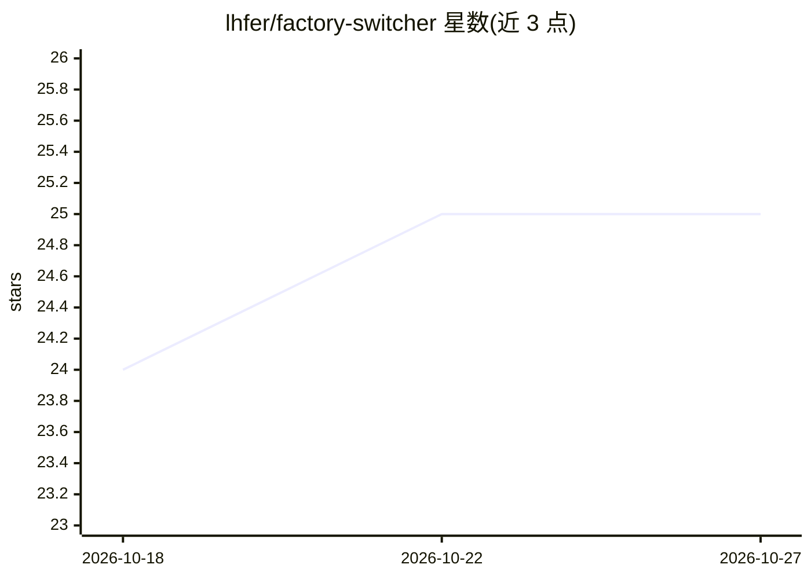

# lhfer/factory-switcher

⭐ 25 · Swift · MIT · 推送 2026-10-02 · [GitHub](https://github.com/lhfer/factory-switcher) · 个人维护 · 中文 README

**macOS 菜单栏应用：一键切换 Factory (Droid) 多账号并查看额度**

非官方社区工具，用于在多个 Factory (Droid) 账号间手动切换：保存当前登录快照（AES-GCM 加密，密钥存 macOS Keychain），切换时先优雅退出 Factory、备份并验证、换登录后重启，失败自动回滚。通过 Factory 自带的 Droid CLI 在隔离 home 中完成官方登录添加；展示各账号 5 小时/周/月剩余额度。Swift + AppKit 原生实现，约 1 MB，无第三方依赖，仅 Apple Silicon + macOS 13+，界面为简体中文。不自动切换、不改服务端配额或计费。

## 筛选速览

| 维度 | 判定 | 备注 |
|---|---|---|
| AI 角色 | `ai-enhanced` | 去掉 AI 部分产品仍成立 |
| 许可风险 | `permissive` | MIT |
| 部署形态 | `None` |  |
| 模型依赖 | — | README 未给出锁定关系 |
| 硬件要求 | — | 无带数字的原话,不猜 |
| 安装摩擦 | `low` | 无编译、无系统依赖或容器化 |
| 成熟度 | — | 结构信号不足 |

## 能力要点

- 备份优先的切换流程：验证后换登录，失败自动恢复原登录
- 登录快照 AES-GCM 加密，密钥存 macOS Keychain
- 各账号 5 小时/周/月剩余额度展示，每 5 分钟刷新（可选）
- Swift + AppKit 原生实现，约 1 MB，零第三方依赖，无遥测

## 适用场景

- 在公司账号与个人账号间手动切换 Factory Droid 登录
- 在菜单栏查看多个账号的剩余额度与重置时间
- 把选定的本地会话带到另一账号继续（opt-in）

## 场景标签

 · 领域:开发者工具/账号管理

## 证据(README 行号)

> L24: If you use Factory Droid with more than one account — say a company org and a personal one —
> L35: |🔁|**One-click switching**|Pick a saved account → Factory quits gracefully, the login is swapped, Factory reopens.|

## 星数曲线

2026-10-18 24 → 2026-10-27 25（+1）

---
*卡片 v1 · prompt 1.4 · 生成 2026-10-27 · 置信度 high · 依据 README sha `2db5205e1e1f` · [字段定义](../../DATASET.md)*
