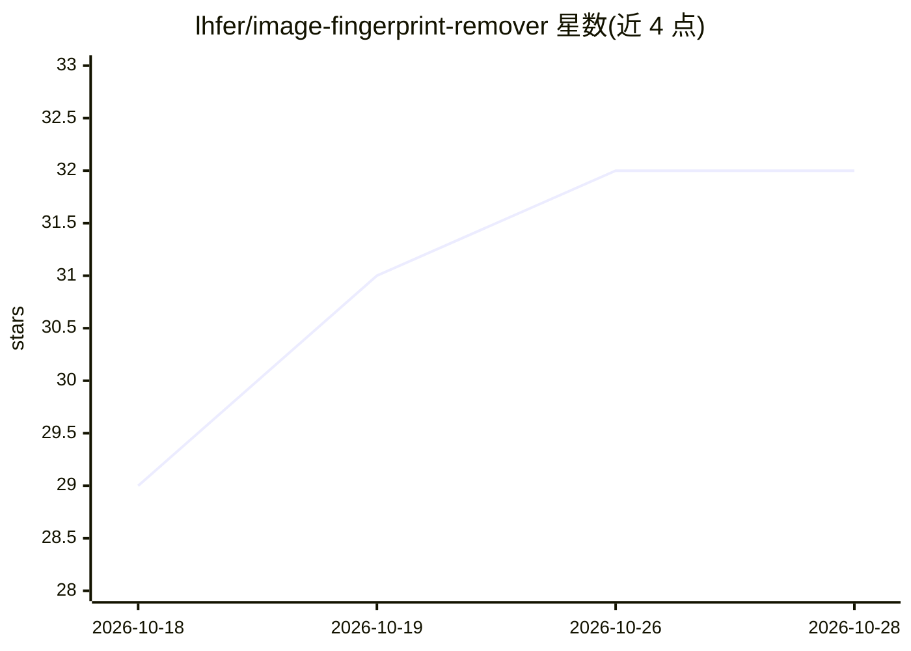

# lhfer/image-fingerprint-remover

⭐ 32 · Python · MIT · 推送 2026-05-21 · [GitHub](https://github.com/lhfer/image-fingerprint-remover) · 个人维护 · 中文 README

**离线清除图像元数据与 AI 指纹的 CLI + 桌面工具**

面向 PNG/JPEG 的图像隐私清理工具：字节级遍历检测 EXIF/GPS、C2PA 内容凭证、Stable Diffusion/ComfyUI/Midjourney 等 AI 提示词块、IPTC AI 标签、Photoshop 历史等 14 类识别元素，并提供三档清理模式——safe（像素字节不变）、paranoid（重编码加轻噪声）、nuclear（缩放裁剪调色以扰乱 SynthID/Digimarc 等鲁棒水印）。以 CLI 与 PySide6 桌面 GUI 双形式提供，100% 本地运行、无遥测。限制：仅支持 PNG/JPEG，核弹模式不保证完全去除鲁棒水印。

## 筛选速览

| 维度 | 判定 | 备注 |
|---|---|---|
| AI 角色 | `ai-enhanced` | 去掉 AI 部分产品仍成立 |
| 许可风险 | `permissive` | MIT |
| 部署形态 | `library` | 以包/库形式分发 |
| 模型依赖 | — | README 未给出锁定关系 |
| 硬件要求 | — | 无带数字的原话,不猜 |
| 安装摩擦 | `low` | 无编译、无系统依赖或容器化 |
| 成熟度 | `idea` | |

## 能力要点

- 字节级检测 PNG/JPEG 的 14 类识别元素（C2PA、AI 提示词块、EXIF/GPS、序列号等）
- 三档清理模式：safe 像素位相同、paranoid 中和量化表指纹、nuclear 扰乱频域水印
- CLI 与 PySide6 桌面 GUI 双形式，支持拖拽、批量、并行检测
- 完全离线运行，无遥测、无云上传

## 适用场景

- 发图到网上前清掉 GPS、相机序列号等隐私元数据
- 去掉 AI 生图附带的提示词与来源凭证
- 批量消毒图像时中和 JPEG 量化表指纹

## 场景标签

 · 领域:图像隐私/元数据工具

## 证据(README 行号)

> L3: > **Strip EXIF, GPS, C2PA / Content Credentials, AI watermarks, and Stable Diffusion / ComfyUI / Midjourney / ChatGP
> L5: A privacy-first desktop app + CLI that removes every identifying fingerprint embedded in your images, with first-cla
> L30:  - `safe` — strip metadata only, pixels byte-identical (verified via SHA256)
> L32:  - `nuclear` — also resize / crop / color-shift to disrupt frequency-domain robust watermarks (Google SynthID, Digi

## 星数曲线

2026-10-18 29 → 2026-10-28 32（+3）

---
*卡片 v1 · prompt 1.4 · 生成 2026-10-26 · 置信度 mid · 依据 README sha `75caf6537f83` · [字段定义](../../DATASET.md)*
