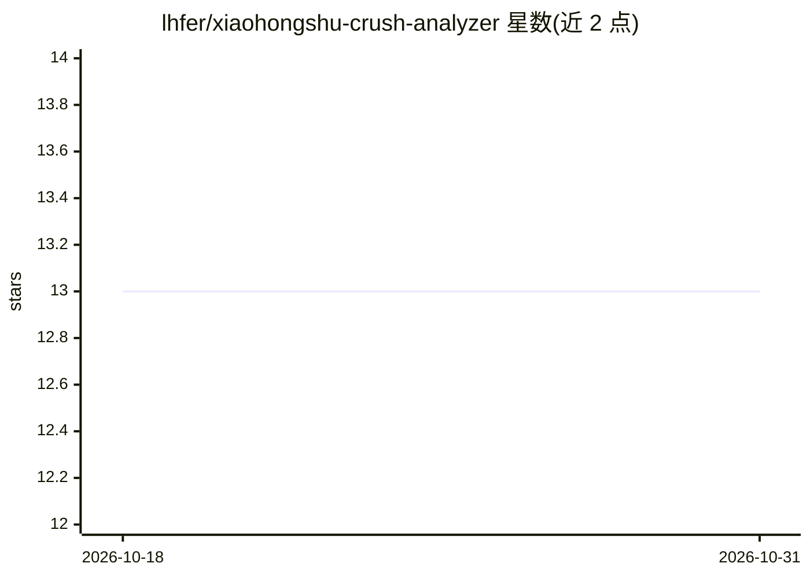

# lhfer/xiaohongshu-crush-analyzer

⭐ 13 · MIT · 推送 2026-03-10 · [GitHub](https://github.com/lhfer/xiaohongshu-crush-analyzer) · [官网](https://lhfer.github.io/xiaohongshu-crush-analyzer/) · 个人维护 · 中文 README

**分析小红书主页生成画像与追求攻略的 Claude Desktop Skill**

面向 Claude Desktop（Cowork 模式）+ Claude in Chrome 扩展的技能包：用户粘贴小红书主页链接后，由 Claude 自动浏览采集全部笔记与收藏，基于 Byrne 相似-吸引、Big Five、Aron 自我扩展、Bowlby 依恋、Dweck 成长型思维 5 套心理学理论生成 7 个 Tab 的交互式 HTML 报告，含五维画像、理想型推断、5 阶段追求策略与话术。安装方式为将 SKILL.md 与 references/ 复制到 Claude Skills 目录；需浏览器登录小红书，未登录仅可见约 10 条笔记；每个推断维度标注置信度，报告含局限性声明。另有纯画像模式可分析博主或竞品账号。

## 筛选速览

| 维度 | 判定 | 备注 |
|---|---|---|
| AI 角色 | `ai-native` | 本体是模型或模型工具 |
| 许可风险 | `permissive` | MIT |
| 部署形态 | `None` |  |
| 模型依赖 | locked-api |  |
| 硬件要求 | — | 无带数字的原话,不猜 |
| 安装摩擦 | `low` | 无编译、无系统依赖或容器化 |
| 成熟度 | — | 结构信号不足 |

## 能力要点

- 自动浏览采集小红书笔记与收藏并生成 7 Tab 交互式 HTML 报告
- 基于 5 套心理学理论的画像与 6 维理想型推断，每条带证据链与置信度
- 5 阶段追求策略含分支应对与基于真实内容的定制话术
- Chrome 扩展断连自动重连逻辑

## 适用场景

- 通过 Claude 分析暗恋对象的小红书获取画像与追求策略
- 纯画像模式分析博主、合作方或竞品账号
- 拖动滑块自测与对方理想型的匹配度

## 场景标签

`网页抓取` · 领域:效率与自动化

## 证据(README 行号)

> L22: 粘贴给 Claude，接下来它会：
> L80: - Claude Desktop（Cowork 模式）
> L111: AI 会自动开始浏览、采集、分析，最后把报告存到 `outputs/` 文件夹。

## 星数曲线

2026-10-18 13 → 2026-10-31 13（+0）

---
*卡片 v1 · prompt 1.4 · 生成 2026-10-31 · 置信度 high · 依据 README sha `9efc5b7226c7` · [字段定义](../../DATASET.md)*
