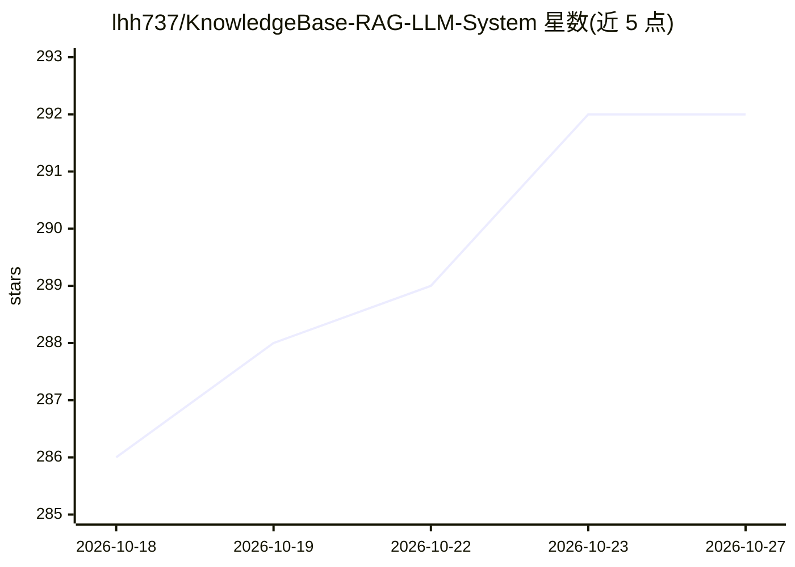

# lhh737/KnowledgeBase-RAG-LLM-System

⭐ 292 · Python · MIT · 推送 2026-10-14 · [GitHub](https://github.com/lhh737/KnowledgeBase-RAG-LLM-System) · 个人维护 · 中文 README

**本地知识库 RAG 问答学习项目：上传 txt 后检索增强问答**

基于 Streamlit 的轻量级 RAG 学习项目：网页上传 .txt 文档，自动切分并以 MD5 去重后写入本地 Chroma 向量库；聊天页面按 Retrieval → Prompt → LLM 链式调用作答，支持流式输出与基于会话历史的连续追问。LLM 与 Embedding 通过 DashScope API（默认 qwen3-max / text-embedding-v4）调用，需自行申请 API Key，无需 GPU。两个 Streamlit 页面（上传、问答）需分别启动，且须使用相同的向量库目录与 collection_name。预置电商客服示例知识库。

## 筛选速览

| 维度 | 判定 | 备注 |
|---|---|---|
| AI 角色 | `ai-native` | 本体是模型或模型工具 |
| 许可风险 | `permissive` | MIT |
| 部署形态 | `library` | 以包/库形式分发 |
| 模型依赖 | — | README 未给出锁定关系 |
| 硬件要求 | `cpu-ok` | |
| 安装摩擦 | `low` | 无编译、无系统依赖或容器化 |
| 成熟度 | — | 结构信号不足 |

## 能力要点

- txt 上传自动切分、MD5 去重写入本地 Chroma 向量库
- RAG 链式调用，支持流式输出与历史连续追问
- 核心配置集中于 config_data.py（模型、chunk、检索数量可调）
- 无需 GPU，依赖轻量，预置电商客服示例知识库

## 适用场景

- RAG 入门学习与本地复现实践
- 替换为自有业务文本搭建小范围知识库问答
- 电商客服类 txt 知识的检索问答演示

## 场景标签

`RAG` `文档问答` · 领域:知识与检索

## 证据(README 行号)

> L15: 一个轻量级、可本地复现的 **RAG（检索增强生成）** 学习项目。上传 `.txt` 文档自动切分入库，再以聊天形式提问，由模型基于检索到的知识库内容作答。
> L18: - **RAG 问答** — `Retrieval → Prompt → LLM → Output` 链式调用，支持流式输出

## 星数曲线

2026-10-18 286 → 2026-10-27 292（+6）

---
*卡片 v1 · prompt 1.4 · 生成 2026-10-22 · 置信度 mid · 依据 README sha `547adc16dd74` · [字段定义](../../DATASET.md)*
