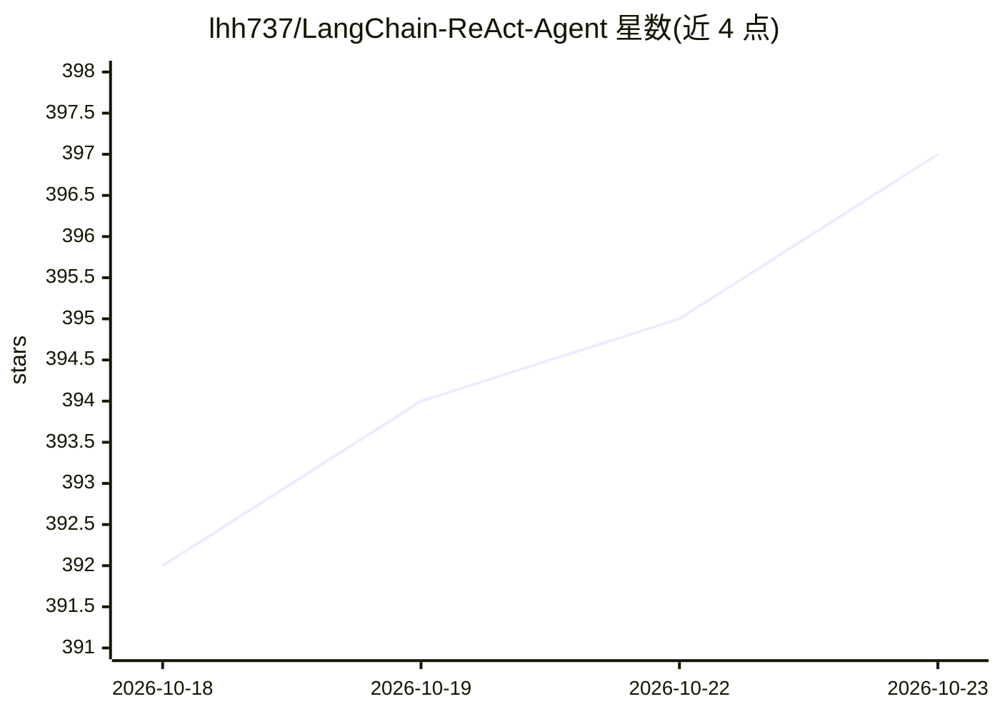

# lhh737/LangChain-ReAct-Agent

⭐ 397 · Python · MIT · 推送 2026-10-14 · [GitHub](https://github.com/lhh737/LangChain-ReAct-Agent) · 个人维护 · 中文 README

**LangChain/LangGraph 的 ReAct Agent 客服系统，含 RAG 与工具调用**

基于 LangChain + LangGraph 构建的 ReAct Agent 应用，按 Thought→Action→Observation 循环自主选择工具：天气查询、用户定位、外部数据检索、报告上下文填充。集成 Chroma 向量库与 DashScope Embedding 的 RAG 检索（支持 txt/pdf 混合加载、MD5 去重），Middleware 按运行时上下文切换普通问答与报告生成两套提示词。前端为 Streamlit 流式界面，展示推理链路。需 Python≥3.10 与 DashScope API Key，配置由 YAML 驱动。

## 筛选速览

| 维度 | 判定 | 备注 |
|---|---|---|
| AI 角色 | `ai-native` | 本体是模型或模型工具 |
| 许可风险 | `permissive` | MIT |
| 部署形态 | `library` | 以包/库形式分发 |
| 模型依赖 | — | README 未给出锁定关系 |
| 硬件要求 | — | 无带数字的原话,不猜 |
| 安装摩擦 | `low` | 无编译、无系统依赖或容器化 |
| 成熟度 | — | 结构信号不足 |

## 能力要点

- ReAct 循环推理并按需调用多工具（天气/定位/外部数据/报告填充）
- Chroma + DashScope Embedding 的 RAG，支持 txt/pdf 混合加载与 MD5 去重
- Middleware 动态切换问答与报告生成两套 System Prompt
- Streamlit 流式界面实时展示 Agent 思考与执行过程

## 适用场景

- 搭建基于自有知识库的智能客服问答
- 让 Agent 多步推理并调用外部工具生成个性化报告
- 学习 LangGraph ReAct Agent 与 RAG 集成的模块化实现

## 场景标签

`RAG` `聊天机器人` · 领域:对话与助手

## 证据(README 行号)

> L15: 基于 LangChain 实现的 **ReAct（Reasoning + Acting）Agent**，集成 RAG 检索增强、多工具调用与动态提示词切换。系统根据用户意图自动判断任务类型（知识问答 / 报告生成），调用合适的工具
> L41: |**ReAct 范式**|Thought → Action → Observation 循环，Agent 自主推理并决定调用哪个工具|

## 星数曲线

2026-10-18 392 → 2026-10-23 397（+5）

---
*卡片 v1 · prompt 1.4 · 生成 2026-10-21 · 置信度 high · 依据 README sha `b114b779987f` · [字段定义](../../DATASET.md)*
