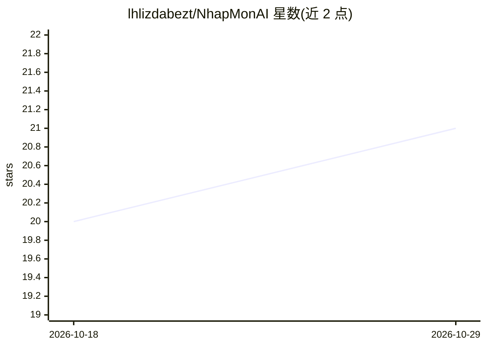

# lhlizdabezt/NhapMonAI

⭐ 21 · Jupyter Notebook · 推送 2026-08-28 · [GitHub](https://github.com/lhlizdabezt/NhapMonAI) · [官网](https://github.com/lhlizdabezt/NhapMonAI/releases/latest) · 个人维护

**越南车牌识别学术原型：YOLO 检测 + OCR 桌面推理**

越南高校（VNUHCM-US 人工智能导论课）第七小组的课程项目归档：用 Ultralytics YOLO 检测车牌区域，配合 FastALPR / fast-plate-ocr 做 OCR 与文本规范化，提供 Tkinter 桌面推理应用，以及通过 HTTP（端口 8765 的 /health 与 /scan）在局域网演示车牌白名单放行的 PlateGate 组件。仓库保留 Jupyter/Kaggle 训练证据、检测器验证集指标、报告与 LFS 托管的检查点。README 声明为学术原型而非生产级系统，且仓库无开源许可证。

## 筛选速览

| 维度 | 判定 | 备注 |
|---|---|---|
| AI 角色 | `ai-native` | 本体是模型或模型工具 |
| 许可风险 | `none` | — |
| 部署形态 | `library` | 以包/库形式分发 |
| 模型依赖 | — | README 未给出锁定关系 |
| 硬件要求 | — | 无带数字的原话,不猜 |
| 安装摩擦 | `medium` | 含编译或系统依赖之一 |
| 成熟度 | — | 结构信号不足 |

## 能力要点

- YOLO 检测 + FastALPR OCR 的完整车牌识别流水线
- 检测器验证集指标：Precision 0.994 / mAP50 0.995（非 OCR 指标）
- Tkinter 桌面应用与 PlateGate 局域网白名单演示（GET /health、POST /scan）
- 保留训练 notebook、Kaggle 证据、检查点与报告等归档资产

## 适用场景

- 课程评审者查看训练证据、指标与报告以复核项目工作
- 在本地克隆仓库并运行桌面车牌识别演示
- 通过 PlateGate 接口测试车牌白名单放行流程

## 场景标签

`目标检测` `OCR` · 领域:感知与多模态

## 证据(README 行号)

> L16: `NhapMonAI` is a Group 05 course project for Vietnamese automatic license plate recognition. It combines a YOLO pla
> L38:   A[Image or video] --> B[YOLO plate detector]
> L40:   C --> D[OCR and text normalization]

## 星数曲线

2026-10-18 20 → 2026-10-29 21（+1）

---
*卡片 v1 · prompt 1.4 · 生成 2026-10-28 · 置信度 high · 依据 README sha `eba2f9aadb7a` · [字段定义](../../DATASET.md)*
