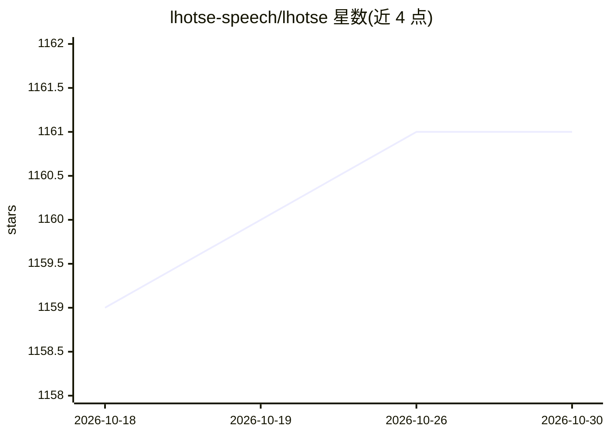

# lhotse-speech/lhotse

⭐ 1,161 · Python · Apache-2.0 · 推送 2026-10-22 · [GitHub](https://github.com/lhotse-speech/lhotse) · [官网](https://lhotse.readthedocs.io/en/latest/) · 组织维护

**语音/多模态机器学习数据准备与加载的 Python 库**

面向语音与多模态（音频、视频、图像、文本）机器学习项目的数据准备工具库，与 k2 共同构成下一代 Kaldi。提供标准数据准备 recipe、人类可读的 manifest 格式、audio cuts 概念（on-the-fly 混合/截断/填充）、Lhotse Shar 顺序 I/O 存储格式，以及与 PyTorch DataLoader 集成的任务专属 Dataset 类。支持分布式多节点训练的数据随机化与去重。需要 Python 3.10+，torchaudio、lilcom、webdataset 等均为可选依赖。

## 筛选速览

| 维度 | 判定 | 备注 |
|---|---|---|
| AI 角色 | `ai-ecosystem` | LLM/agent 周边工具 |
| 许可风险 | `permissive` | Apache-2.0 |
| 部署形态 | `library` | 以包/库形式分发 |
| 模型依赖 | — | README 未给出锁定关系 |
| 硬件要求 | — | 无带数字的原话,不猜 |
| 安装摩擦 | `medium` | 含编译或系统依赖之一 |
| 成熟度 | — | 结构信号不足 |

## 能力要点

- audio cuts 抽象支持 on-the-fly 混合、截断、填充以节省存储
- Lhotse Shar 顺序 I/O 存储格式（类似 webdataset），支持 WebDataset 集成
- 面向常用语料的标准化数据准备 recipe 与 PyTorch Dataset 类
- Kaldi 兼容层（kaldi_native_io、kaldifeat）与 lilcom 特征压缩可选安装

## 适用场景

- 为语音识别/语音任务训练准备和加载数据
- 将多语料数据集混合、去重后用于分布式训练
- 把数据编译为 WebDataset tarball 提升读取效率

## 场景标签

`MLOps` · 领域:训练与推理

## 证据(README 行号)

> L13: Lhotse is a Python library aiming to make multimodal (speech, audio, video, image, text) data preparation flexible 
> L52: Like Kaldi, Lhotse provides standard data preparation recipes, but extends that with a seamless PyTorch integration

## 星数曲线

2026-10-18 1,159 → 2026-10-30 1,161（+2）

---
*卡片 v1 · prompt 1.4 · 生成 2026-10-21 · 置信度 high · 依据 README sha `03353d0bc0b7` · [字段定义](../../DATASET.md)*
