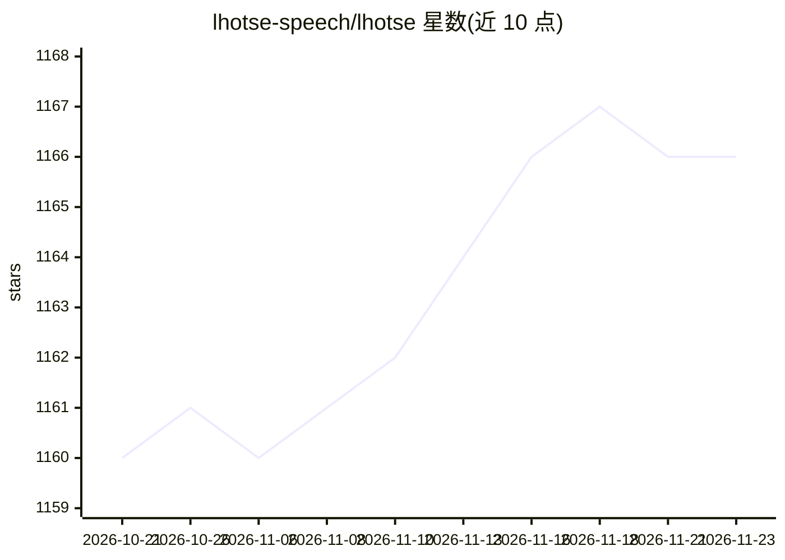

# lhotse-speech/lhotse

⭐ 1,166 · Python · Apache-2.0 · 推送 2026-11-20 · [GitHub](https://github.com/lhotse-speech/lhotse) · [官网](https://lhotse.readthedocs.io/en/latest/) · 组织维护

**多模态数据集准备与 PyTorch 数据管道构建库**

Python 库，为音频、视频、图像和文本提供清单（manifest）表示，配合在线增强、动态分批、分片存储与可断点续传的 dataloading，用于构建可扩展的 PyTorch 数据管道。核心抽象是 RecordingSet、SupervisionSet 与 CutSet，清单以 JSONL 懒加载方式流式处理，无需全部载入内存。要求 Python 3.11+ 与 PyTorch；torchaudio、TorchCodec、FFmpeg 等为可选后端。安装走 PyPI 或源码，另提供 Colab 教程与常用语料库的 recipe。

## 筛选速览

| 维度 | 判定 | 备注 |
|---|---|---|
| AI 角色 | `ai-ecosystem` | LLM/agent 周边工具 |
| 许可风险 | `permissive` | Apache-2.0 |
| 部署形态 | `library` | 以包/库形式分发 |
| 模型依赖 | — | README 未给出锁定关系 |
| 硬件要求 | — | 无带数字的原话,不猜 |
| 安装摩擦 | `medium` | 含编译或系统依赖之一 |
| 成熟度 | — | 结构信号不足 |

## 能力要点

- 多模态清单表示（音频/视频/图像/文本），含 Python 与 CLI API
- JSONL 清单懒加载与流式过滤、混洗、数据集混合
- 按时长动态分批与分布式 rank 切分，减少 padding
- Lhotse Shar 分片存储与索引化、可断点续传的 dataloading

## 适用场景

- 为语音识别/多模态训练准备大规模数据集清单
- 构建可断点续传的多 worker PyTorch DataLoader
- 导入导出 Kaldi 格式数据或对接 WebDataset
- 在 Colab 中运行数据管道教程笔记本

## 场景标签

`语音识别` `多模态` · 领域:感知与多模态

## 证据(README 行号)

> L15: Lhotse is a Python library for preparing multimodal datasets and building scalable
> L16: PyTorch data pipelines. It provides manifests for audio, video, images, and text,
> L118: - Icefall: speech recognition recipes combining

## 星数曲线

2026-10-21 1,160 → 2026-11-23 1,166（+6）

---
*卡片 v1 · prompt 1.4 · 生成 2026-11-23 · 置信度 high · 依据 README sha `cdca38c36881` · [字段定义](../../DATASET.md)*
