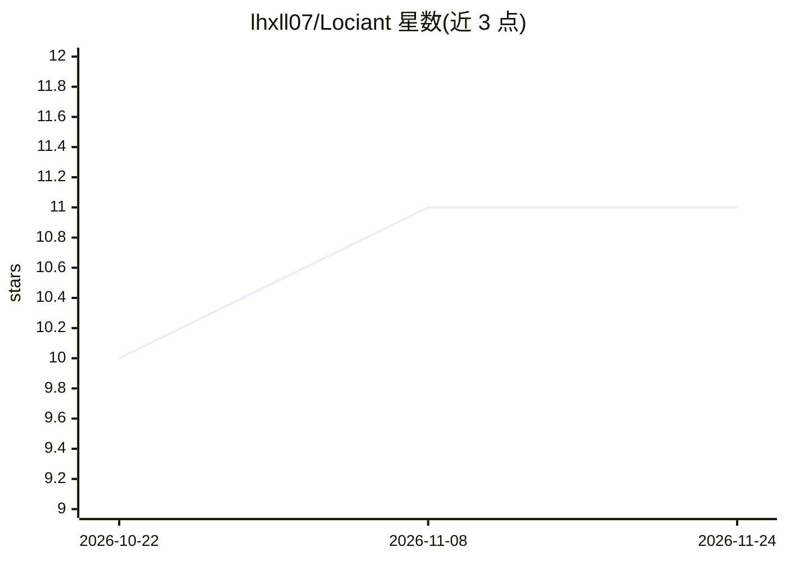

# lhxll07/Lociant

⭐ 11 · C++ · MIT · 推送 2026-11-13 · [GitHub](https://github.com/lhxll07/Lociant) · 个人维护

**把手机、开发板、小型 Linux 变成可经 MCP 调用的本地 AI 边缘节点**

面向低功耗常开边缘设备的本地运行时：将安卓手机、Rockchip 开发板与小型 Linux 系统变为边缘节点，节点上运行 GGUF 本地模型（llama.cpp）、读取传感器与相机、暴露设备工具（屏幕/无障碍/文件/进程），并通过 MCP Streamable HTTP 与控制 API（端口 11434）供云端或桌面客户端编排调用。运行时在能力执行前检查工具暴露级别（read/sensor/action）与 remoteAllowed 策略，执行与权限留在边缘。明确声明不是聊天客户端，不运行通用 Agent 循环。

## 筛选速览

| 维度 | 判定 | 备注 |
|---|---|---|
| AI 角色 | `ai-ecosystem` | LLM/agent 周边工具 |
| 许可风险 | `permissive` | MIT |
| 部署形态 | `None` |  |
| 模型依赖 | local-ok | 支持本地模型 |
| 硬件要求 | — | 无带数字的原话,不猜 |
| 安装摩擦 | `medium` | 含编译或系统依赖之一 |
| 成熟度 | — | 结构信号不足 |

## 能力要点

- 导入 GGUF 模型，节点本地以 llama.cpp 进程推理
- MCP Streamable HTTP 与控制 API 对外暴露模型与工具
- 工具暴露三级（read/sensor/action）加 remoteAllowed 策略运行时检查
- Rockchip 板经 RKLLM NPU 运行时支持无头部署

## 适用场景

- 把闲置安卓手机变成局域网内的本地模型与设备能力节点
- 在低功耗开发板上常驻运行本地推理供远程编排
- 云端或桌面客户端通过 MCP 调用边缘设备的传感器与工具

## 场景标签

`推理引擎` · 领域:训练与推理

## 证据(README 行号)

> L18: and desktop clients can use these nodes through MCP or the control API, while
> L21: Lociant is not a chat client and does not run a general-purpose Agent loop.
> L55: |Android phone|Full edge node for device capabilities and local models|Flutter console + Rust backend + Kotlin devi

## 星数曲线

2026-10-22 10 → 2026-11-24 11（+1）

---
*卡片 v1 · prompt 1.4 · 生成 2026-11-18 · 置信度 high · 依据 README sha `87aaaacf8c90` · [字段定义](../../DATASET.md)*
