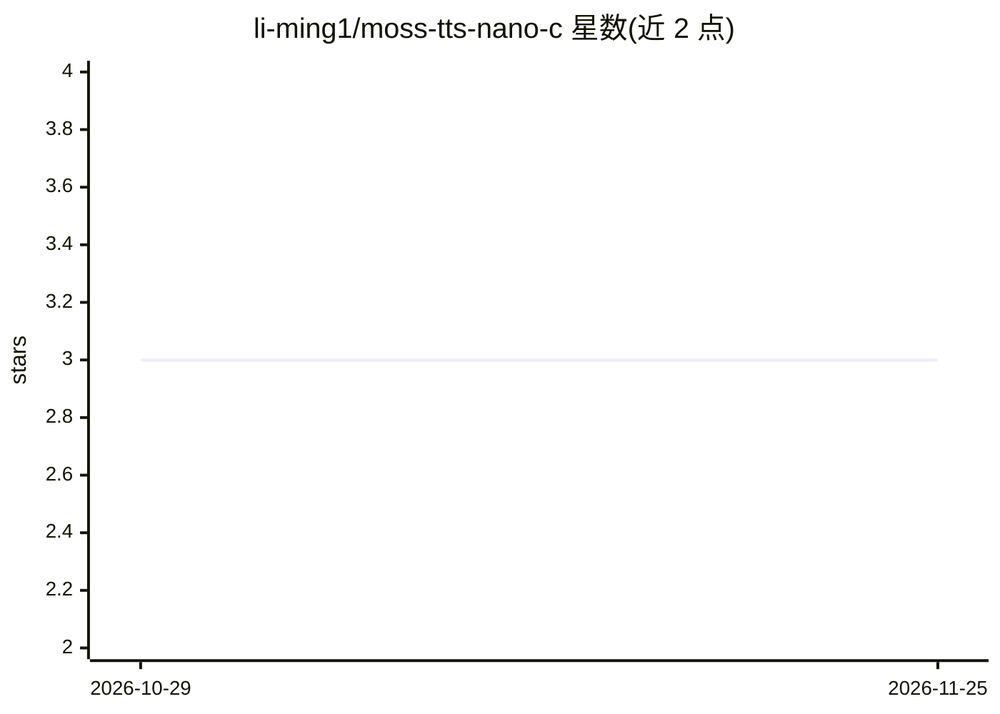

# li-ming1/moss-tts-nano-c

⭐ 3 · C++ · Apache-2.0 · 推送 2026-10-28 · [GitHub](https://github.com/li-ming1/moss-tts-nano-c) · 个人维护 · 中文 README

**Windows CPU 上的 MOSS-TTS-Nano 单文件 C11 流式语音合成**

OpenMOSS MOSS-TTS-Nano (0.1B) 的单文件 C11 推理实现，仅依赖 onnxruntime.dll 与静态 CRT，通过 build.bat（MSVC 2022）构建。支持合成到 wav、边生成边播放、常驻 server 流式播放，--chat 模式接外部大模型 API 做多轮语音对话（SSE 按句切开、首句一到即播）。提供 18 个预置音色与 --ref-wav 参考音频实时克隆。默认启用 int8/int4 双量化，已知边界包括偶发音色漂移与长文合成感。

## 筛选速览

| 维度 | 判定 | 备注 |
|---|---|---|
| AI 角色 | `ai-native` | 本体是模型或模型工具 |
| 许可风险 | `permissive` | Apache-2.0 |
| 部署形态 | `desktop` | 安装包/桌面程序 |
| 模型依赖 | — | README 未给出锁定关系 |
| 硬件要求 | — | 无带数字的原话,不猜 |
| 安装摩擦 | `low` | 无编译、无系统依赖或容器化 |
| 成熟度 | — | 结构信号不足 |

## 能力要点

- 单翻译单元 C11 实现，运行时 LoadLibrary 加载 onnxruntime.dll
- --server 流式模式与 --chat 大模型语音对话（SSE 按句切分、思维链跳过）
- --ref-wav 任意参考音频实时克隆，可保存为官方格式音色
- int8+int4 双量化与异步流水线设计，--fp32 一键回退

## 适用场景

- 在 Windows CPU 上将文本合成为语音并实时播放
- 用参考音频克隆音色并存为可复用音色
- 配合大模型 API 搭建语音对话终端

## 场景标签

`语音合成` `语音 Agent` · 领域:对话与助手

## 证据(README 行号)

> L5: OpenMOSS MOSS-TTS-Nano (0.1B) 的单文件 C11 推理实现:
> L7: 目标是 Windows CPU 上的准实时流式语音合成。

## 星数曲线

2026-10-29 3 → 2026-11-25 3（+0）

---
*卡片 v1 · prompt 1.4 · 生成 2026-11-21 · 置信度 high · 依据 README sha `4f3843052991` · [字段定义](../../DATASET.md)*
