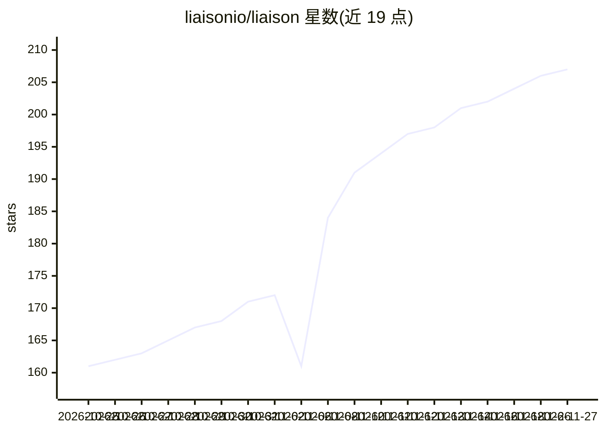

# liaisonio/liaison

⭐ 207 · Go · AGPL-3.0 · 推送 2026-11-15 · [GitHub](https://github.com/liaisonio/liaison) · [官网](https://liaison.cloud) · 组织维护 · 中文 README

**自托管私有应用与本地 LLM/Agent 的安全访问网关**

运行在自有 Linux 服务器上的自托管控制平面，通过仅出站连接器访问内网服务，无需在被访问设备上开放入站端口。功能覆盖本地 LLM 的认证 API 共享（带 key 作用域、Token 配额、用量追踪）、浏览器内使用 Codex 与 Claude Code（可恢复会话、权限提示）、code-server 浏览器 IDE、Web SSH/RDP/VNC、多数据库浏览器工作区，以及可检查终端输出、起草命令、按权限查询数据库并需审批的内置 Agent。采用 AGPLv3 许可。

## 筛选速览

| 维度 | 判定 | 备注 |
|---|---|---|
| AI 角色 | `ai-ecosystem` | LLM/agent 周边工具 |
| 许可风险 | `viral` | AGPL-3.0 |
| 部署形态 | `None` |  |
| 模型依赖 | local-ok | 支持本地模型 |
| 硬件要求 | — | 无带数字的原话,不猜 |
| 安装摩擦 | `low` | 无编译、无系统依赖或容器化 |
| 成熟度 | — | 结构信号不足 |

## 能力要点

- 仅出站连接器接入私有设备，无需开入站端口
- 本地 LLM 经认证 API 共享，支持 key 作用域、Token 配额与用量追踪
- 浏览器内使用 Codex 与 Claude Code，会话可恢复并带权限提示
- 支持 SSH/SFTP、RDP/VNC、多协议数据库等浏览器工作区

## 适用场景

- 在浏览器安全访问内网的 SSH、远程桌面与数据库
- 把本地模型以受控 API 分享给团队并管理配额
- 远程使用 Codex/Claude Code 操作自己的设备
- 不暴露内网的前提下继续使用内部 AI 助手

## 场景标签

`模型网关` `编码 Agent` · 领域:Agent 开发

## 证据(README 行号)

> L25: - 🤖 **Local LLM access** — Share local models through authenticated APIs and a browser Playground.
> L26: - 🔑 **Controlled API sharing** — Scope keys to models, set Token quotas, revoke access, and track usage.
> L65:  LLM upstream protocols OpenAI-compatible &nbsp;&nbsp; Anthropic Messages&nbsp;&nbsp; Ollama

## 星数曲线

2026-10-25 161 → 2026-11-27 207（+46）

---
*卡片 v1 · prompt 1.4 · 生成 2026-11-25 · 置信度 high · 依据 README sha `db757ec21258` · [字段定义](../../DATASET.md)*
