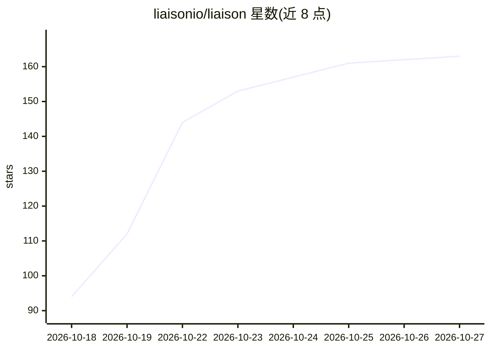

# liaisonio/liaison

⭐ 163 · Go · AGPL-3.0 · 推送 2026-10-23 · [GitHub](https://github.com/liaisonio/liaison) · [官网](https://liaison.cloud) · 组织维护 · 中文 README

**自托管访问网关：安全接入私有应用、本地 LLM 与 AI agent**

自托管的私有服务访问平台：通过仅出站连接器接入内网设备，在浏览器中提供终端、远程桌面、数据库与缓存等工作区（SSH/RDP/VNC/MySQL/MongoDB 等）。LLM 层面支持 OpenAI 兼容、Anthropic Messages 与 Ollama 上游协议，可共享本地模型并按模型、Token 配额管理 API key；支持在浏览器中使用 Codex 与 Claude Code agent 会话，内置可配置 8 种模型预设的 Agent 辅助终端与数据库查询。以 Docker bundle（Docker 20.10+）在 Linux 服务器部署，AGPLv3 许可，由 liaisonio 维护。

## 筛选速览

| 维度 | 判定 | 备注 |
|---|---|---|
| AI 角色 | `ai-ecosystem` | LLM/agent 周边工具 |
| 许可风险 | `viral` | AGPL-3.0 |
| 部署形态 | `None` |  |
| 模型依赖 | local-ok | 支持本地模型 |
| 硬件要求 | — | 无带数字的原话,不猜 |
| 安装摩擦 | `low` | 无编译、无系统依赖或容器化 |
| 成熟度 | — | 结构信号不足 |

## 能力要点

- 仅出站连接器接入私有设备，无需开放入站端口
- 本地 LLM 共享：API key 作用域、Token 配额与用量跟踪，支持 OpenAI 兼容/Anthropic/Ollama 上游
- 浏览器中使用 Codex 与 Claude Code，会话可恢复、带权限提示
- 浏览器工作区覆盖 SSH、RDP、VNC、多种 SQL/NoSQL 数据库与 S3 浏览

## 适用场景

- 在自有服务器上集中管理对内网应用与本地模型的访问
- 通过浏览器终端和远程桌面操作私有设备，全程审计
- 给团队分发受限的 LLM API key 并跟踪用量

## 场景标签

`模型网关` · 领域:Agent 开发

## 证据(README 行号)

> L3: > **Self-hosted access to private apps, LLMs, and AI agents.**
> L25: - 🤖 **Local LLM access** — Share local models through authenticated APIs and a browser Playground.
> L64:  LLM upstream protocols OpenAI-compatible &nbsp;&nbsp; Anthropic Messages&nbsp;&nbsp; Ollama

## 星数曲线

2026-10-18 94 → 2026-10-27 163（+69）

---
*卡片 v1 · prompt 1.4 · 生成 2026-10-22 · 置信度 high · 依据 README sha `f3df75ed89a1` · [字段定义](../../DATASET.md)*
