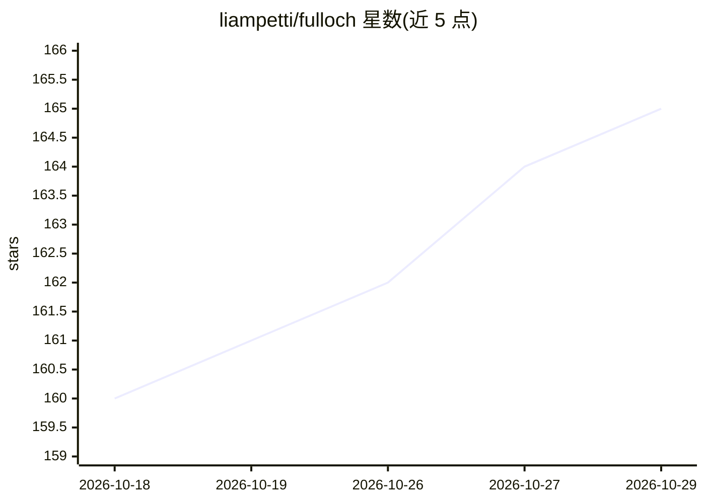

# liampetti/fulloch

⭐ 165 · Python · MIT · 推送 2026-10-13 · [GitHub](https://github.com/liampetti/fulloch) · 个人维护

**本地运行的家庭语音助手：语音对话、笔记与智能家居控制**

以 Docker 部署在个人 PC/Mac 上的本地语音助手：通过浏览器仪表盘或 ESP32 卫星设备进行自然语音对话，支持语音读写与语义搜索 Obsidian 笔记库、以自然语言控制 Home Assistant 灯光/门锁/窗帘/媒体/日程等，并经 SearXNG 获取网页答案。语音识别、TTS、语言模型默认全部本地运行（CPU/GPU 双栈），可显式选择外部 OpenAI 兼容端点（此时界面变为 Parloch 标识）。MIT 许可，部分可选模型组件另有许可条款。

## 筛选速览

| 维度 | 判定 | 备注 |
|---|---|---|
| AI 角色 | `ai-native` | 本体是模型或模型工具 |
| 许可风险 | `permissive` | MIT |
| 部署形态 | `self-host` | docker 或自建部署 |
| 模型依赖 | local-ok | 支持本地模型 |
| 硬件要求 | — | 无带数字的原话,不猜 |
| 安装摩擦 | `low` | 无编译、无系统依赖或容器化 |
| 成熟度 | — | 结构信号不足 |

## 能力要点

- ASR/TTS/语言模型默认全本地运行，语音与对话历史留在本机
- 语音读写与语义搜索 Obsidian 笔记库，记忆事实跨重启持久化
- Home Assistant HACS 集成：状态传感器、麦克风控制、主动播报与自动化触发
- 正则快速路径与 Laya 本地语义命令层，常规指令无需语言模型

## 适用场景

- 用语音操作家里的灯光、门锁、窗帘和媒体设备
- 口述捕获想法并搜索自己的 Obsidian 笔记库
- 在本地跑一套不把语音数据外传的家庭语音助手

## 场景标签

`语音 Agent` `知识库管理` · 领域:对话与助手

## 证据(README 行号)

> L9: Fulloch is your privacy-focused local voice assistant running on your own PC or Mac. Ask questions, capture thoughts
> L79: |Speech recognition (ASR)|Qwen3-ASR ONNX 1.7B or 0.6B; Parakeet TDT v3 ONNX 0.6B; Moonshine Base or Tiny|Qwen3-ASR 
> L80: |Text to speech (TTS)|Kokoro 82M; Pocket TTS ONNX voice cloning|Qwen3-TTS PyTorch 1.7B or 0.6B; Qwen3-TTS GGUF 1.7B

## 星数曲线

2026-10-18 160 → 2026-10-29 165（+5）

---
*卡片 v1 · prompt 1.4 · 生成 2026-10-22 · 置信度 high · 依据 README sha `44595761695e` · [字段定义](../../DATASET.md)*
