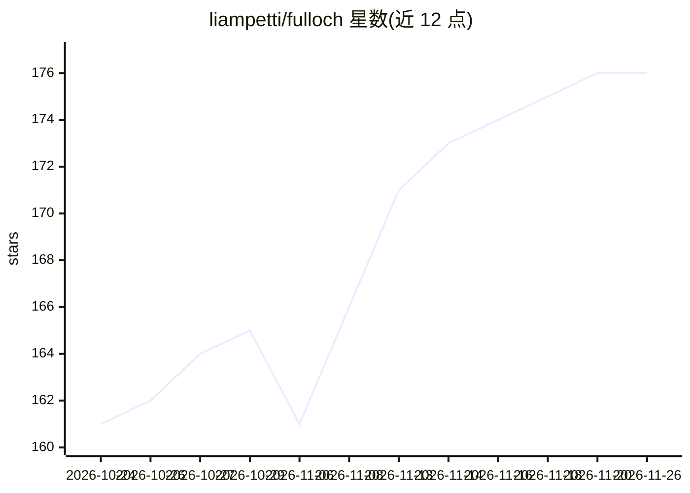

# liampetti/fulloch

⭐ 176 · Python · MIT · 推送 2026-11-13 · [GitHub](https://github.com/liampetti/fulloch) · 个人维护

**全本地语音助手：语音控制智能家居、笔记与网络检索**

运行在自有机器上的本地语音助手，通过浏览器仪表盘或 ESP32-S3 卫星设备交互；语音、语言处理、笔记、事实记忆与对话历史默认留在本地。支持语音控制 Home Assistant 设备、以语音读写并语义检索 Obsidian 笔记、经自托管 SearXNG 获取带来源的网络摘要，可外接 OpenAI 兼容端点（此时切换为 Parloch 模式）。提供按 GPU 显存分级的五档模型预设，CPU 与 NVIDIA GPU 两套 Docker 镜像。深度研究、规划功能为进行中状态。

## 筛选速览

| 维度 | 判定 | 备注 |
|---|---|---|
| AI 角色 | `ai-native` | 本体是模型或模型工具 |
| 许可风险 | `permissive` | MIT |
| 部署形态 | `self-host` | docker 或自建部署 |
| 模型依赖 | — | README 未给出锁定关系 |
| 硬件要求 | `cpu-ok` | |
| 安装摩擦 | `low` | 无编译、无系统依赖或容器化 |
| 成熟度 | — | 结构信号不足 |

## 能力要点

- 语音控制 Home Assistant 灯光、锁具、媒体、日历等，HassIL 匹配实现多语言近即时命令
- 语音读写、追加与语义检索 Obsidian vault，记忆事实跨重启持久化
- 五档硬件预设（Lite 无 GPU 至 Max 32GB），含 Qwen3-ASR/TTS、Moonshine、Kokoro 等模型
- 自托管 SearXNG 提供带来源摘要；自检 cgroup 内存并在压力下暂停本地推理

## 适用场景

- 不想让语音数据离开本地的情况下控制家庭设备
- 用语音记录想法并语义检索我的 Obsidian 笔记
- 在家里多个房间部署 ESP32 卫星做语音交互
- 通过自托管搜索获取带来源的问答

## 场景标签

`语音 Agent` `知识库管理` `语义搜索` · 领域:对话与助手

## 证据(README 行号)

> L9: Fulloch is your privacy-focused local voice assistant running on your own computer. Control your home via **Home Ass
> L24: - **Local processing** - speech, language processing, notes, facts, and conversation history stay on your machine u
> L100: |Preset|GPU capacity class|AI|Speech-to-text|Text-to-speech|

## 星数曲线

2026-10-24 161 → 2026-11-26 176（+15）

---
*卡片 v1 · prompt 1.4 · 生成 2026-11-26 · 置信度 high · 依据 README sha `75a3aab90cd9` · [字段定义](../../DATASET.md)*
