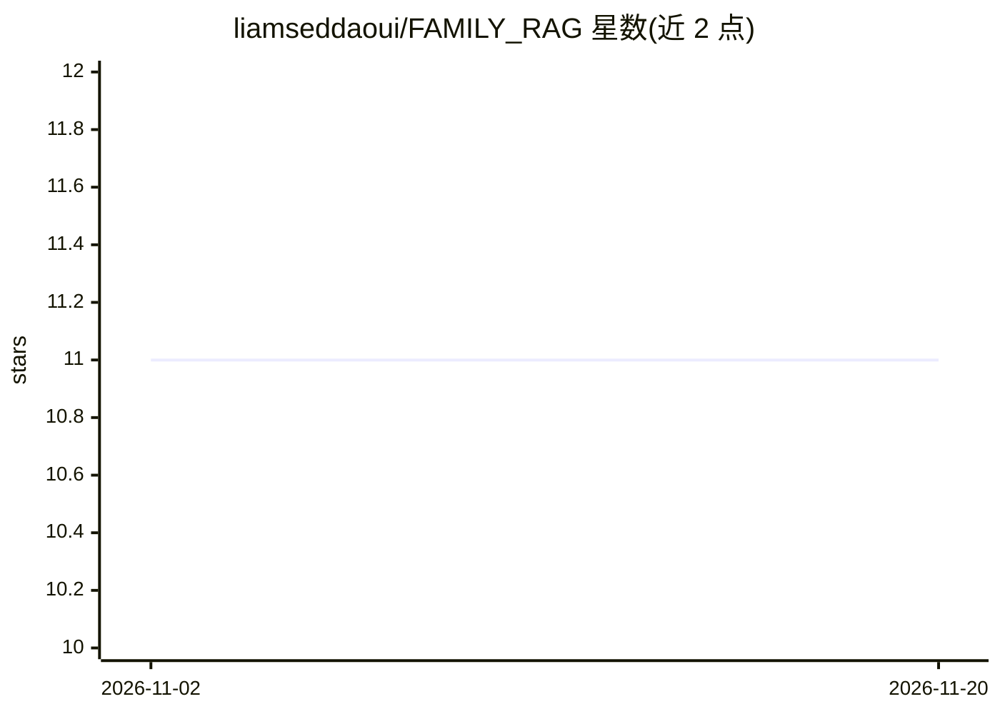

# liamseddaoui/FAMILY_RAG

⭐ 11 · Python · MIT · 推送 2026-11-01 · [GitHub](https://github.com/liamseddaoui/FAMILY_RAG) · [官网](liamseddaoui.com) · 个人维护

**本地家庭文档 RAG 问答系统：自然语言检索私有文件**

FamilyRAG 是一个完全本地运行的 RAG 系统，面向希望对家庭文档（行政文件、扫描件、邮件、课程、图书）进行自然语言问答的家庭用户。技术栈为 FastAPI + LangChain + FAISS + Ollama（默认 Ministral 3），通过 Docker 部署，端口绑定 127.0.0.1 且无认证。支持 PDF/TXT/MD/DOCX/EML/JPG/PNG，图像走 Tesseract OCR 与 Vision 模型分析。提供 LLM 重排序、强制引用来源、索引选择性、会话持久化、系统监控仪表盘；旧版索引不兼容需重建。

## 筛选速览

| 维度 | 判定 | 备注 |
|---|---|---|
| AI 角色 | `ai-native` | 本体是模型或模型工具 |
| 许可风险 | `permissive` | MIT |
| 部署形态 | `self-host` | docker 或自建部署 |
| 模型依赖 | local-ok | 支持本地模型 |
| 硬件要求 | — | 无带数字的原话,不猜 |
| 安装摩擦 | `low` | 无编译、无系统依赖或容器化 |
| 成熟度 | — | 结构信号不足 |

## 能力要点

- 完全本地运行，数据不经云端（Ollama 本地推理）
- LLM 重排序与强制引用来源（[document.pdf]）
- 支持 7 种文件格式，图像含 Tesseract OCR 与 Vision 分析
- Web 界面可切换 LLM/embedding 模型、管理会话与选择性索引

## 适用场景

- 在家中对家庭行政文件与扫描件提问并获取带引用的回答
- 检索和查询个人图书、食谱、邮件档案
- 无需联网或云服务的前提下搭建私有文档问答

## 场景标签

`文档问答` · 领域:知识与检索

## 证据(README 行号)

> L23: **FamilyRAG** est un système RAG (Retrieval-Augmented Generation) entièrement local, conçu pour les familles qui so
> L115: - **Ollama 0.13.1+** (requis pour Ministral 3)
> L154: docker compose up -d --build

## 星数曲线

2026-11-02 11 → 2026-11-20 11（+0）

---
*卡片 v1 · prompt 1.4 · 生成 2026-11-18 · 置信度 mid · 依据 README sha `fe7091c40ea5` · [字段定义](../../DATASET.md)*
